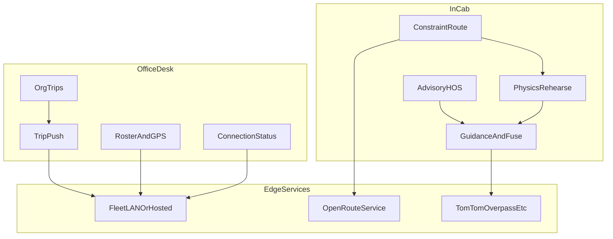
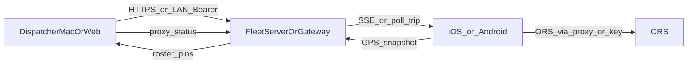
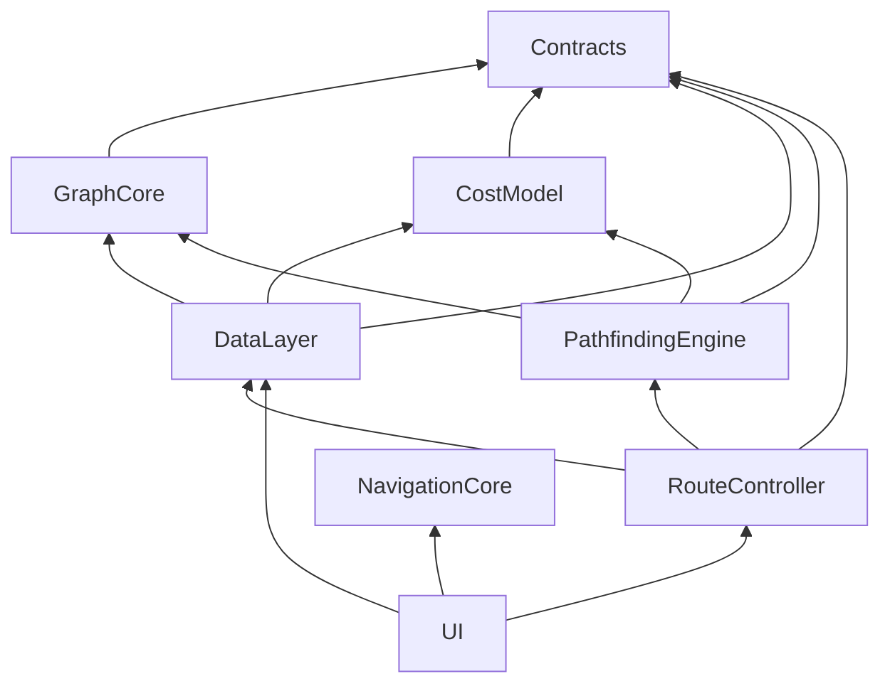
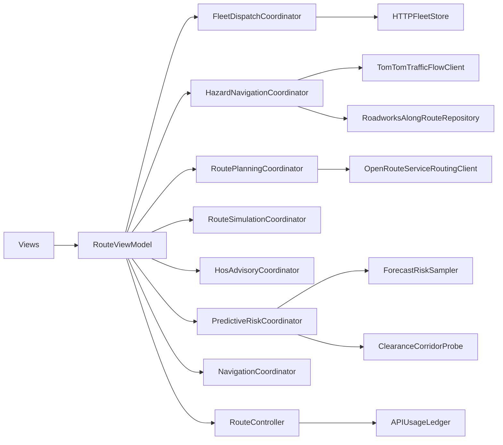
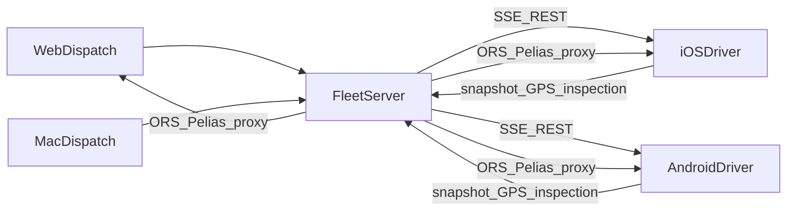
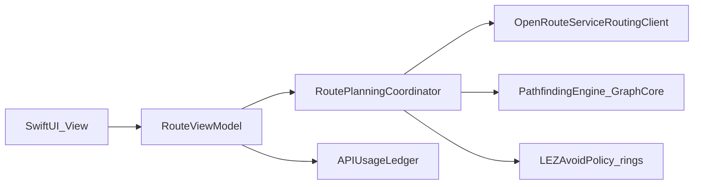
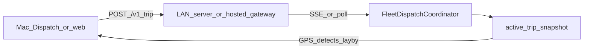
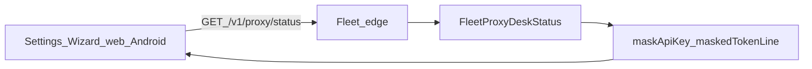

# RouteFinder — Senior Full-Stack Technical Monograph

**Title:** RouteFinder — A Constraint-Aware UK HGV Navigator and Fleet Desk  
**Subtitle:** Senior Full-Stack Technical Monograph (living)  
**Author / owner:** Jacob Hackett  
**Document type:** Production engineering monograph — Analysis → Design → Implementation → Testing → Evaluation → Appendices; **no client interviews**  
**Repository:** proprietary — see root [`LICENSE`](../LICENSE)  
**Last updated:** 2026-11-11  
**Status:** **senior monograph — pass 2 shipped** (Implementation depth §3); next = pass 3 Testing/Evaluation; product residuals remain secrets-gated

Integers, CI evidence, and phase verification remain authoritative in [`competitive-feature-scorecard.md`](competitive-feature-scorecard.md), [`engineering-test-matrix.md`](engineering-test-matrix.md), and relevant `phase*` Docs. This monograph states invariants, trust boundaries, contracts, and failure modes, and points at those SSOTs for greppable proof.

Gated product work (Android Auto / offline packs, CarPlay production entitlements, VU partner SDK, live toll £ feeds, HD lane assets, Stripe billing, further country PBF) resumes only when unlocked by name.

---

## Abstract

**Problem.** UK HGV operators need constraint-faithful routing, pre-trip kinetic rehearsal, advisory HOS planning, and desk↔cab coupling over LAN or hosted HTTPS — without treating consumer maps or VU-less SaaS as substitutes for legal tachograph authority.

**Method.** Requirements are derived from documented buyer personas ([`buyer-personas-uk-hgv.md`](buyer-personas-uk-hgv.md)) and competitive scorecard gaps, not client interviews. Prioritisation uses `(competitor best − RF) × persona weight × driver_impact`, then a gate filter that excludes paid-entitlement work unless unlocked. Claims require greppable evidence graded as symbol / unit test / CI job / Doc SSOT.

**Contribution.** A multi-surface native system: iOS/Mac Swift 6 package + Android C2 fleet driver + `web-dispatch` desk + LAN/`hosted-gateway` `/v1/*` fleet API, with Account-Manager-lite Connection identity (`orgId`/`orgName` + meters), UK living-layer advisories (open-data densified LEZ rings including Sheffield / Birmingham / Bradford / Bristol / Bath; named toll £), physics rehearsal, and advisory HOS — while labelling residuals honestly.

**Limitations.** Production CarPlay/Android Auto, legal VU download, live operator tariffs, HD lane visuals, Stripe billing, and unbounded London ULEZ avoid remain gated or ORS-capped. Authored LEZ/toll data is **not** legal cadastre or live class tariffs.

---

## Document control

| Field | Value |
|-------|--------|
| Primary file | `Docs/project-writeup.md` |
| Edition | Senior monograph pass 2 (Implementation depth) |
| Related indexes | [`developer-map.md`](developer-map.md), root [`README.md`](../README.md) |
| Architecture SSOT | [`architecture.md`](architecture.md) |
| Competitive SSOT | [`competitive-feature-scorecard.md`](competitive-feature-scorecard.md), [`ultimate-competitive-excellence-sweep.md`](ultimate-competitive-excellence-sweep.md) |
| Fleet API contract | [`fleet-api-schema.json`](fleet-api-schema.json) |
| Evidence rule | No claim without greppable symbol, test, CI job, or Doc SSOT |

---

## Table of contents

1. [Analysis](#1-analysis)
   - [1.1 Problem statement](#11-problem-statement)
   - [1.2 Background](#12-background)
   - [1.3 Stakeholders and personas](#13-stakeholders-and-personas)
   - [1.4 Research into the problem](#14-research-into-the-problem)
   - [1.5 Alternative solutions](#15-alternative-solutions)
   - [1.6 Objectives](#16-objectives)
   - [1.7 Modelling the problem](#17-modelling-the-problem)
   - [1.8 Requirements derivation](#18-requirements-derivation)
   - [1.9 Constraints](#19-constraints)
   - [1.10 Assumptions](#110-assumptions)
2. [Design](#2-design)
   - [2.1 Design goals / rationale](#21-design-goals--rationale)
   - [2.2 System architecture](#22-system-architecture)
   - [2.3 Data / class design](#23-data--class-design)
   - [2.4 Algorithm / planning design](#24-algorithm--planning-design)
   - [2.5 Interface design](#25-interface-design)
   - [2.6 Data dictionary](#26-data-dictionary)
   - [2.7 Objective traceability matrix](#27-objective-traceability-matrix)
   - [2.8 Threat model and trust boundaries](#28-threat-model-and-trust-boundaries)
   - [2.9 Concurrency and consistency](#29-concurrency-and-consistency)
   - [2.10 Cross-surface API contract](#210-cross-surface-api-contract)
   - [2.11 Observability and fair-use](#211-observability-and-fair-use)
   - [2.12 Failure and degradation matrix](#212-failure-and-degradation-matrix)
3. [Implementation](#3-implementation)
   - [3.1 Implementation overview](#31-implementation-overview)
   - [3.2 Graph / routing implementation](#32-graph--routing-implementation)
   - [3.3 Route planning / coordinators](#33-route-planning--coordinators)
   - [3.4 Pathfinding / offline engines](#34-pathfinding--offline-engines)
   - [3.5 Cost model, preferences, vehicle constraints](#35-cost-model-preferences-vehicle-constraints)
   - [3.6 Multi-stop / fleet dispatch](#36-multi-stop--fleet-dispatch)
   - [3.7 UI implementation by surface](#37-ui-implementation-by-surface)
   - [3.8 Error handling and robustness](#38-error-handling-and-robustness)
   - [3.9 Automated testing integration](#39-automated-testing-integration)
   - [3.10 Objective fulfilment confirmation](#310-objective-fulfilment-confirmation)
4. [Testing](#4-testing)
   - [4.1 Testing strategy](#41-testing-strategy)
   - [4.2 Unit testing](#42-unit-testing)
   - [4.3 Routing / algorithm testing](#43-routing--algorithm-testing)
   - [4.4 Cost model and constraint testing](#44-cost-model-and-constraint-testing)
   - [4.5 Edge case and robustness testing](#45-edge-case-and-robustness-testing)
   - [4.6 Performance / fair-use](#46-performance--fair-use)
   - [4.7 Test evidence](#47-test-evidence)
   - [4.8 Objective verification table](#48-objective-verification-table)
5. [Evaluation](#5-evaluation)
   - [5.1 Method of developer evaluation](#51-method-of-developer-evaluation)
   - [5.2 Comparison against original objectives](#52-comparison-against-original-objectives)
   - [5.3 Limitations](#53-limitations)
   - [5.4 Maintenance and future work](#54-maintenance-and-future-work)
6. [Appendices](#6-appendices)
   - [Appendix A — Objectives traceability](#appendix-a--objectives-traceability)
   - [Appendix B — Document index](#appendix-b--document-index)
   - [Appendix C — Screenshots](#appendix-c--screenshots)
   - [Appendix D — Data sources](#appendix-d--data-sources)
   - [Appendix E — Glossary](#appendix-e--glossary)
7. [Document changelog](#7-document-changelog)

---

## 1. Analysis

### 1.1 Problem statement

UK HGV drivers and small-fleet transport managers must plan and execute journeys under vehicle-specific constraints that consumer navigation systems routinely ignore or under-specify: low bridges, weight limits, length/width restrictions, hazmat / ADR tunnel codes, Low Emission Zones (LEZ) / Clean Air Zones (CAZ), named tolls, and legally mandated driving and rest limits under EU Regulation 561 and the Working Time Directive (WTD).

Failures of constraint-aware planning produce operational and legal risk: unsuitable roads, unexpected LEZ exposure, missed rest opportunities, inflated ETAs that do not reflect grade or kinetic reality, and office–cab disconnect when depot Wi‑Fi or LAN pairing fails. Enterprise telematics (e.g. Samsara, Geotab) emphasises compliance download and fleet tracking; dedicated truck navigators (e.g. Sygic Truck, CoPilot) emphasise maps and guidance; few systems combine **constraint routing**, **physics rehearsal**, **advisory HOS**, and a **lightweight fleet desk** that works on LAN or hosted HTTPS without becoming a multi-tenant SaaS billing product.

**Problem to solve:** design and ship a coherent product that (a) routes HGVs under explicit constraints, (b) rehearses kinetic risk and produces shareable trip documentation, (c) advises HOS without claiming VU authority, (d) supports iOS and Android C2 in-cab use plus Mac/web dispatch, and (e) remains honest about residuals that require paid partner entitlements or licensed data.

### 1.2 Background

#### Domain

Articulated and rigid HGVs operating UK long-haul and regional trunking face:

- **Physical constraints** — height, weight, length, width, axle load, hazmat classifications.
- **Spatial policy** — LEZ/CAZ charging and access rules; authored avoid polygons are a pragmatic approximation of legal cadastre.
- **Economic friction** — named tolls (e.g. M6 Toll, Dartford, Tyne, Mersey) where indicative £ advisories help commit/avoid decisions before live operator feeds exist.
- **Temporal law** — daily/weekly driving limits, breaks, fortnight and WTD ceilings; the VU is authoritative for enforcement.
- **Operational coupling** — office staff push multi-stop jobs; drivers need toast/SSE handoff, GPS snapshots for roster pins, and Connection clarity (depot identity, masked token, API meters).

#### Product thesis

RouteFinder is positioned as a **native HGV navigator and fleet desk**, not a public multi-tenant portal. Core experience:

- **In-cab** — iOS gold-standard driver app; Android C2 fleet driver on a depot-issued handset (CarPlay / Android Auto not required for pilots).
- **Office desk** — Mac/iPad dispatch plus `web-dispatch` for Windows/Linux PCs.
- **Connectivity** — `RouteFinderFleetServer` on office LAN, or Operator hosted gateway over HTTPS with org bearer tokens.
- **UK living layer** — RegCheck/DVLA plate profiles, truck POIs, LEZ/toll/layby/hazard overlays, crowd reports fused with TomTom where configured.

#### Legal posture (non-negotiable)

RouteFinder’s HOS clock, imported card remainings, and “Can I drive now?” answers are **planning aids only**. They must not be used as a substitute for the legal tachograph record or enforcement decisions. LEZ rings are authored / open-data densified approximations, not certified cadastral boundaries. Toll £ figures are named advisories, not live operator class tariffs unless a paid feed is unlocked.

### 1.3 Stakeholders and personas

No client interviews are used in this writeup. Needs are taken from the committed persona Doc [`buyer-personas-uk-hgv.md`](buyer-personas-uk-hgv.md) and from competitive scoring practice in the sweep / scorecard.

| Stakeholder | Role | Primary needs |
|-------------|------|----------------|
| Owner-operator (“Dave”) | 1 tractor; personal iPhone; high budget sensitivity | Constraint routing, break/layby guidance, LEZ awareness, voice/map at junctions, physics rehearsal, degraded-signal resilience |
| Small fleet operator (“Sarah”) | 2–20 vehicles; Mac/iPad office | Push trip with constraints, physics ETA, shareable trip brief, LAN discovery without heavy IT, optional layby prediction on active trips |
| Android-heavy fleet (secondary) | Depot Android handsets | Fleet ORS proxy (no driver HeiGIT key), MapLibre nav, SSE handoff, Connection wizard/home parity |
| Hosted-remote desk (secondary) | Depot Wi‑Fi unreliable | HTTPS gateway, named depot profiles, `/v1/proxy/status` org identity + meters |

**Deal-breakers captured from personas (honest):** routes through unsuitable village infrastructure; surprise LEZ entry; no break planning on long legs; opaque subscription with no differentiation; entitlement-gated CarPlay on personal teams; smaller offline footprint than Sygic-class Europe packs.

### 1.4 Research into the problem

Research is documentary and competitive, not interview-based. The method is explicit so ranking can be audited.

#### Methodology

1. **Collect** — Public competitor pages / upgrade notes (CoPilot, Sygic Truck, TomTom GO Truck, TRAVIS×Trimble; Samsara/Geotab when HOS/VU is in scope), via Firecrawl or equivalent; notes stay local (do not commit scrapes).
2. **Score** — Maintain Lead / Parity / Gap integers in [`competitive-feature-scorecard.md`](competitive-feature-scorecard.md); tag residuals to epics (`EPIC-CARPLAY-PROD`, `EPIC-ANDROID-AUTO`, `EPIC-VU-PARTNER`, `EPIC-LEZ-CADASTRE`, `EPIC-TOLL-DEPTH`, `EPIC-LANE-DEPTH`, `EPIC-HOSTED-DESK`).
3. **Weight** — Apply OO + SF (and Android / hosted) weights from [`buyer-personas-uk-hgv.md`](buyer-personas-uk-hgv.md).
4. **Rank** — Prefer slices maximising `(competitor best − RF) × persona weight × driver_impact`, after verifying the gap is still open in greppable symbols (not stale Doc checkboxes).
5. **Gate** — Skip work that needs paid Apple/partner secrets, live tariff APIs, or Stripe unless unlocked by name. Free open-data catalog fills (ORS-safe LEZ densify) are allowed when residual coarse holes remain.
6. **Sequence** — [`ultimate-competitive-excellence-sweep.md`](ultimate-competitive-excellence-sweep.md) records agent-doable vs secrets-gated order and shipped MVP slices.

#### Evidence grades

| Grade | Meaning | Example |
|-------|---------|---------|
| **S** | Greppable symbol / type | `FleetProxyDeskStatus`, `UKLowEmissionZoneBoundaries` |
| **T** | Automated unit/integration test | `FleetProxyDeskStatusTests`, `ukLezBristolAndBathDensifiedUnderOrsCap` |
| **C** | CI job green | `macos` / `ios` / `web-dispatch` / `android-c1` / `hosted-gateway` |
| **D** | Doc SSOT row | scorecard Shipped vs Residual; phase verification |

A claim is **auditable** only when it cites at least one of S/T/C/D. Marketing-only competitor fluff does not move scorecard integers.

#### Findings relevant to analysis

- Physics rehearsal and advisory HOS+desk coupling are differentiators relative to pure truck-nav peers (**S/T**).
- Offline depth and production CarPlay/Android Auto remain competitor leads where RouteFinder is gated or MVP-limited (**D**).
- Hosted multi-depot **org identity + Connection meters** shipped as Account-Manager-lite; Stripe self-serve billing remains out of scope (**S/T/D**).
- Open-data LEZ densify MVP includes Sheffield / Birmingham / Bradford / Bristol / Bath (ORS-safe); residual coarse zones + London ORS-blocked (**S/T/D**). Free densify continues only for remaining ORS-safe coarse holes — not unbounded London ULEZ, not live £.

### 1.5 Alternative solutions

| Class | Examples | Strengths | Gaps vs RouteFinder thesis |
|-------|----------|-----------|----------------------------|
| Consumer maps | Apple Maps, Google Maps | Ubiquity, UX polish | Weak HGV constraint fidelity; no fleet desk; no physics rehearsal |
| Truck navigators | Sygic Truck, CoPilot, TomTom GO Truck | Offline packs, LEZ depth, AA/CarPlay maturity | Limited physics rehearsal; desk often separate or enterprise-priced; subscription friction for owner-operators |
| Fleet telematics | Samsara, Geotab | VU/compliance download, tracking | Navigation/physics not core; heavier IT footprint |
| Open routing stacks | ORS + OSM tooling, GraphHopper | Transparent constraints API | Not a full cab+desk product; no HOS/walkaround/dispatch UX |
| Educational / research routers | Student Dijkstra/A* GUIs | Algorithm pedagogy | Not production multi-surface fleet systems |

**Conclusion:** Build a focused native product that uses ORS (and hybrid offline where shipped) for constraint routing, adds physics + advisory compliance + desk sync, and documents gated gaps honestly rather than claiming enterprise VU or licensed cadastre parity.

### 1.6 Objectives

#### 1.6.1 Functional objectives (FO)

| ID | Objective | Surface evidence (shipped MVP unless noted) |
|----|-----------|-----------------------------------------------|
| FO1 | Plan HGV routes under length/width/height/weight/axle/hazmat/ADR constraints | ORS via planning stack; trailer→ORS length ladder on cab/desk |
| FO2 | Support multi-stop jobs and office→driver trip push | Fleet server + Mac/web dispatch; SSE/toast handoff |
| FO3 | Rehearse kinetic risk and export trip brief (text/PDF) | Physics / rehearsal engines; shareable brief |
| FO4 | Advise HOS (561/WTD) and Can-I-drive day/week without claiming VU authority | HOS advisory modules; desk week cards; legal disclaimer |
| FO5 | Provide UK living-layer advisories (LEZ, tolls, laybys, hazards, plate profile) | Catalogs + HUD/TTS/desk indicative £; RegCheck/DVLA when configured |
| FO6 | Operate desk+driver on LAN or hosted HTTPS with clear Connection status | Fleet server / hosted-gateway; `/v1/proxy/status` orgId/orgName + meters on web/Mac/Android |
| FO7 | Ship Android C2 fleet driver as ORS-proxy thin client | `android-fleet-driver/`; [`android-c2-gate.md`](android-c2-gate.md) |
| FO8 | Enrich lane/street guidance via OSM Overpass within caps | Overpass ≤12/route; residual HD visuals gated |

#### 1.6.2 Non-functional objectives (NFO)

| ID | Objective | Approach |
|----|-----------|----------|
| NFO1 | Modular architecture; no HTTP from Views | Swift package modules + coordinators ([`architecture.md`](architecture.md)) |
| NFO2 | Strict concurrency / async I/O | Swift 5.9+ / Swift 6 package norms; actors for shared mutable state |
| NFO3 | Consistent glass UI | `GlassmorphicModifiers` on SwiftUI chrome |
| NFO4 | Secrets hygiene | No committed API keys; mask tokens in UI and screenshots |
| NFO5 | Remote reliability | `RemoteRequestPolicy` timeouts/retries/429 handling |
| NFO6 | Verifiability | Unit/CI gates (`swift test`, `npm test`, `android-c1`) + phase Docs |
| NFO7 | Honest Docs SSOT | Scorecard/sweep/writeup updated when surfaces ship |

#### 1.6.3 Measurable success criteria

| Criterion | Measurement |
|-----------|-------------|
| Constraint route returns usable geometry for valid HGV profile | Automated routing/planning tests + manual stranger path in [`getting-started.md`](getting-started.md) |
| Trip push visible on paired driver | Fleet E2E / LAN checklist [`fleet-e2e-qa.md`](fleet-e2e-qa.md) |
| Proxy status shows depot identity + meters on Connection Test | Greppable UI parity (web `maskApiKey`, Mac Settings/Wizard, Android wizard/home) |
| CI green for package + web + Android job | `.github/workflows/ci.yml` |
| Legal disclaimer present for HOS | README + in-product advisory copy |
| Residuals labelled, not claimed Shipped | Scorecard Gated/Residual rows |

#### 1.6.4 Objective validation criteria

An FO is **validated** when: (1) greppable implementation exists on the claimed surface(s); (2) automated tests or a named phase/CI job cover the critical path where applicable; (3) Docs (scorecard or gate Doc) mark Shipped (MVP) vs Residual without contradiction. An NFO is validated by architecture rules, CI, and Docs honesty checks in the same PR week as surface changes.

### 1.7 Modelling the problem

#### 1.7.0 Problem decomposition



#### 1.7.1 Routing / graph model

Production routing for live HGV plans is primarily **ORS-backed** with vehicle profile parameters. Offline / hybrid pathfinding uses in-package graph tiles (H3) and cost models where downloaded — see module graph in [`architecture.md`](architecture.md) (`GraphCore`, `CostModel`, `PathfindingEngine`). This writeup does not equate the product to a single educational Dijkstra/A* CSV graph; those algorithms may appear inside offline engines but the operator-facing contract is constraint-aware route requests + rehearsal + desk sync.

#### 1.7.2 Surface / deployment model

| Node | Responsibility |
|------|----------------|
| iOS / Mac app | UI, coordinators, local rehearsal, fleet client |
| Android C2 | Kotlin thin client; fleet proxy routing; MapLibre |
| `web-dispatch` | React desk; Connection profiles; roster; indicative tolls; layby card |
| Fleet server | LAN `/v1/*`, Bearer auth, fair-use, push |
| Hosted gateway | HTTPS Operator deployment of the same API family |
| External APIs | ORS, TomTom, Overpass, RegCheck/DVLA, OpenWeather (when configured) |

#### 1.7.3 Level-0 data flow (desk ↔ driver)



#### 1.7.4 Summary

The system is modelled as coordinated cab and desk clients sharing a fleet API, with routing and live enrichment as external services, and with legal/compliance boundaries enforced in product copy and residual labelling.

### 1.8 Requirements derivation

Requirements are derived by intersecting:

1. Persona jobs-to-be-done (constraint route, breaks, LEZ, push trip, physics ETA, Connection clarity).
2. Competitive gaps that are agent-doable without inventing secrets-gated epics.
3. Hard engineering rules (glass UI, concurrency, secrets, Docs honesty).

Each FO in §1.6 traces to at least one persona job and one verification path. Residuals that need Apple entitlements, VU partner SDKs, Stripe, or licensed live tariffs are recorded as **constraints** (§1.9), not as silently deferred FOs.

### 1.9 Constraints

| Constraint | Impact |
|------------|--------|
| Proprietary codebase / no public redistribution without agreement | Documentation may link paths but must not leak secrets |
| HeiGIT ORS avoid-polygon area caps | London-wide ULEZ avoid not shippable as unbounded polygon |
| Personal vs paid Apple Developer team | CarPlay production entitlements inactive until paid team |
| Android Auto / deep offline packs | Product-gated per [`android-c2-gate.md`](android-c2-gate.md) |
| No VU partner SDK in-session | Legal remote VU download residual |
| No Stripe keys / billing product scope | Hosted desk stops at Account-Manager-lite |
| Anti-grind policy | No mid-corridor / LEZ densify / toll-£ clones without measurable gap or catalog hole |
| Fair-use API metering | Soft budgets / ledger; meters exposed on proxy status |

### 1.10 Assumptions

1. Operators can obtain ORS (and optional TomTom/OpenWeather) credentials or use fleet proxy keys configured by the depot — drivers on fleet mode do not need personal HeiGIT keys.
2. LAN or hosted Connectivity is available for desk↔driver push; solo drivers may use on-device ORS keys.
3. Authored LEZ rings and named toll advisories are acceptable for MVP with clear non-legal / non-live labelling.
4. CI on GitHub Actions plus local `swift test` / `npm test` is sufficient automated evidence for ungated surfaces; physical device smoke remains optional via phase checklists.
5. Persona Docs remain a valid substitute for client interviews for analysis and prioritisation in this writeup.
6. Future gated unlocks will be named explicitly before implementation rather than inferred.

---

## 2. Design

Design decisions implement the Analysis objectives (§1.6) within the constraints of §1.9. Detailed module rules remain SSOT in [`architecture.md`](architecture.md); this section records rationale, structure, data, planning behaviour, UI principles, and FO/NFO traceability.

### 2.1 Design goals / rationale

| Goal | Rationale | Maps to |
|------|-----------|---------|
| Modular Swift package boundaries | Keep Contracts pure; isolate GraphCore / CostModel / PathfindingEngine / DataLayer / RouteController / UI so routing and fleet I/O can evolve without View-layer HTTP | NFO1, FO1 |
| Coordinator extraction from `RouteViewModel` | Domain boundaries (fleet, hazards, planning, simulation, HOS, predictive risk) reduce god-object merge risk; hosts keep `@Observable` state | NFO1, FO2–FO5 |
| Centralised remote policy | One timeout/retry/429 policy for ORS, TomTom, fleet, RegCheck/DVLA | NFO5 |
| Glassmorphic UI consistency | Single modifier family across SwiftUI chrome for operator familiarity | NFO3 |
| Account-Manager-lite, not Stripe SaaS | Hosted org identity + meters close desk Connectivity gap without billing product scope | FO6, §1.9 |
| Cross-surface API parity | Same `/v1/*` family for Mac, web, iOS, Android | FO2, FO6, FO7 |

#### Technology selection

| Layer | Choice | Justification |
|-------|--------|---------------|
| Apple cab/desk | Swift 6 SPM + SwiftUI + MapLibre (WKWebView) | Native performance; shared package across iOS/Mac; glass UI |
| Live HGV routing | HeiGIT OpenRouteService | Constraint parameters (dimensions, hazmat/ADR) without maintaining a full commercial map stack |
| Hybrid offline | H3 graph tiles + PathfindingEngine / CostModel | Degraded-signal resilience for OO persona; not Sygic-class country packs |
| Android C2 | Kotlin thin client + MapLibre | Fleet ORS proxy; no driver HeiGIT key; parity slices vs iOS |
| Office PC desk | Vite + React (`web-dispatch`) | Windows/Linux operators without requiring a Mac |
| Hosted edge | Workers / VPS gateway | HTTPS when LAN fails; same contract as LAN server |

#### Design trade-offs and limitations

| Choice | Upside | Failure consequence if wrong |
|--------|--------|------------------------------|
| ORS dependency vs fully self-hosted graph | Fast constraint coverage + global HGV profiles | Provider outage/429 → route failure banners; area caps block London-wide ULEZ avoid |
| Account-Manager-lite vs Stripe billing UI | Depot identity + meters without SaaS scope | No self-serve seat billing; Operator must mint tokens |
| Open-data LEZ / named tolls vs licensed feeds | Ship advisories now with honest labelling | False precision risk if Docs claim “legal cadastre” or “live £” — forbidden |
| Coordinator hosts vs big-bang TCA rewrite | Incremental extraction; testable with in-memory fleet fixtures | Residual god-object pressure if new domains skip extraction ADR |

#### System invariants (must hold)

| Invariant | Enforcement |
|-----------|-------------|
| No HTTP from Views | Architecture rule; I/O via `RouteController` / `DataLayer` |
| Contracts are pure | No `URLSession` in Contracts module |
| VU is legal authority | Product copy + HOS advisory labelling; no VU-download claim |
| Tokens never unmasked in UI/Docs shots | `maskApiKey` / `maskedTokenLine`; screenshot policy |
| LEZ avoid rings under ORS area soft cap | `LEZAvoidPolicy.avoidPolygonAreaCapSquareMeters`; London omitted from avoid set |
| Cross-surface fleet contract aligned | [`fleet-api-schema.json`](fleet-api-schema.json) + mirrored DTOs |
| Catalog triple-sync for shared UK data | Swift + Android + `web-dispatch` in one PR when catalogs move |

### 2.2 System architecture

#### Module dependency graph (Swift package)



**Rules:** (1) No HTTP from Views — remote I/O via `RouteController` or `DataLayer`. (2) Contracts are pure models/formatters/metering. (3) Coordinators own async orchestration; `RouteViewModel` remains the observation root.

#### Coordinator end-state



| Coordinator | Responsibility |
|-------------|----------------|
| `FleetDispatchCoordinator` | Poll/SSE dispatch, snapshot publish, Bonjour discovery, fleet store reload |
| `HazardNavigationCoordinator` | TomTom sampling, roadworks corridor, crowd hydrate, hazard overlay/voice |
| `PredictiveRiskCoordinator` | Fuse kinetic / weather / hazard / roadworks / traffic / schedule / forecast / clearance → primary HUD |
| `RoutePlanningCoordinator` | Search mapping, LEZ avoid rings, recalculate debounce, lane enrichment, traffic reroute, failures |
| `RouteSimulationCoordinator` | Simulation callbacks, kinetic advisories, physics ETA / rehearse, Break Now, layby voice |
| `HosAdvisoryCoordinator` | Duty transitions, can-I-drive, tacho import/persistence, rest forecast |

Supporting modules: `ForecastRiskSampler`, `ClearanceCorridorProbe`. Logging categories: `routing`, `geocode`, `fleet`, `metering`.

#### Desk to driver (LAN / hosted)



Mac and web desks poll active-trip snapshots (roster status / physics ETA / GPS age / defects; yard pins from cab GPS, not live VU). Hosted gateway preserves the same API family over HTTPS ([`hosted-gateway-deployment.md`](hosted-gateway-deployment.md)).

#### Error handling and safety

`RemoteRequestPolicy` centralises timeout, retry, exponential backoff with jitter, and HTTP 429 / `Retry-After` for ORS, TomTom, fleet HTTP, and DVLA/RegCheck. User-visible banners cover missing ORS/fleet configuration; Connection UIs mask API tokens. Fair-use soft budgets surface via metering ledger and proxy-status meters.

#### Extensibility points

- Routing client behind planning coordinator (ORS today; offline hybrid where tiles exist).
- UK catalogs (LEZ rings, toll advisories) as data, not hard-wired UI.
- Fleet proxy providers (TomTom / OpenWeather / Overpass) via server configuration.
- Additional coordinators only if `RouteViewModel` remains a merge hotspot (architecture ADR).

### 2.3 Data / class design

| Concept | Role | FO link |
|---------|------|---------|
| Vehicle / constraint profile | Dimensions, axle, hazmat/ADR, trailer→ORS length ladder | FO1 |
| Job / trip brief | Stops, vehicle profile, physics ETA, shareable text/PDF brief | FO2, FO3 |
| `FleetProxyDeskStatus` | `orgId` / `orgName`, masked key presentation, ORS (and related) meters — [`fleet-api-schema.json`](fleet-api-schema.json) | FO6 |
| Active-trip snapshot | Status, GPS, defects, optional `predictedLayby` for desk card/pin | FO2, FO5 |
| HOS advisory state | Duty clocks, remainings, can-I-drive day/week (non-authoritative) | FO4 |
| `RouteRiskAdvisory` / fuse inputs | Kinetic, traffic, hazard, roadworks, schedule, forecast, clearance | FO5 |
| Toll / LEZ advisory records | Named £ hints; authored avoid polygons | FO5 |
| API usage ledger | Soft budgets / burn visibility | NFO5, FO6 |

Rationale: keep wire contracts (fleet JSON Schema) and Swift/Kotlin/TS mirrors aligned so Connection and roster behaviour stay triple-surface honest. Pure Contracts types avoid URLSession coupling (NFO1).

### 2.4 Algorithm / planning design

| Concern | Design approach | Failure / limit |
|---------|-----------------|-----------------|
| Live HGV route | Shape ORS directions with vehicle constraints; optional avoid-tolls / LEZ `avoid_polygons` | Provider errors → user-visible failure; area caps block unbounded London ULEZ |
| Traffic reroute | TomTom flow sampling may trigger ORS recalculation with avoid polygons | Falls back to prior route / heuristic when live samples unavailable |
| Hybrid offline | H3 tiles + PathfindingEngine / CostModel when downloads present; corridor prefetch after Find (capped) | Not Sygic-class Europe packs; Android offline gated |
| Predictive fuse | Combine kinetic, weather, hazard, roadworks, traffic, schedule, forecast, clearance into primary HUD | Individual samplers degrade independently |
| Toll advisories | Match corridor to named UK catalog (indicative £; Mersey/Dunham/Batheaston among seeded entries) | Not live operator class tariffs |
| Lane enrichment | OSM Overpass `turn:lanes` with caps (≤12/route, STRAIGHT skip, ~50 km) | Residual HD visuals |
| HOS advisory | Clock + import + can-I-drive rules as planning aid | VU remains legal authority |

Complexity is dominated by network-bound ORS/live calls and fuse sampling, not by a single educational shortest-path coursework graph. Offline engines may use classical graph search internally; operator-facing design remains constraint request + rehearsal + desk sync.

### 2.5 Interface design

| Surface | Design principles |
|---------|-------------------|
| iOS / Mac SwiftUI | `GlassmorphicModifiers` (`glassPanel`, `controlSheetStyle`, …); Settings / FleetSetupWizard Connection Test shows depot + masked token + meters; dispatch roster and toll/layby panels |
| web-dispatch | Connection profiles per depot token; proxy status; roster/GPS age; indicative corridor tolls; predicted layby card/pin |
| Android C2 | FleetSetupWizard Test + DriverHome badge via shared label helpers; MapLibre nav; metric TTS |
| Stranger path | Role picker and first-run flows in [`getting-started.md`](getting-started.md) |

Accessibility and operator clarity: mask secrets in UI and screenshots; prefer explicit Test/status copy over silent failures; keep CarPlay/AA out of pilot-required paths while entitlements remain inactive.

### 2.6 Data dictionary

| Name | Meaning | Notes |
|------|---------|-------|
| `orgId` / `orgName` | Hosted/LAN depot identity from `/v1/proxy/status` | Account-Manager-lite; not billing customer id |
| API key (masked) | Bearer / proxy credential display | Never commit or screenshot unmasked |
| ORS meters / fair-use fields | Usage counters on proxy status | Soft budgets via ledger |
| Vehicle dimensions / axle / hazmat | Constraint profile inputs to ORS | Trailer count → length ladder |
| Active-trip snapshot | Cab-published trip state for desk roster | GPS age = snapshot freshness |
| `predictedLayby` | Desk layby prediction payload | Not live bay sensors |
| Corridor toll advisories | Named UK £ hints along preview geometry | Indicative only |
| HOS duty / remainings | Advisory clocks and imports | Non-authoritative vs VU |
| LEZ avoid rings | Authored polygons for ORS avoid | Not legal cadastre |

### 2.7 Objective traceability matrix

| ID | Design component | Primary path / symbol area | Test column |
|----|------------------|----------------------------|-------------|
| FO1 | ORS planning + constraint profile | `RoutePlanningCoordinator` / ORS client | §4 |
| FO2 | Fleet dispatch + SSE/REST | `FleetDispatchCoordinator`, fleet server, web/Mac desk | §4 |
| FO3 | Physics rehearsal + brief | `RouteSimulationCoordinator` / physics engines | §4 |
| FO4 | HOS advisory | `HosAdvisoryCoordinator` | §4 |
| FO5 | UK living layer + fuse | Hazard / predictive coordinators; catalogs | §4 |
| FO6 | Connection + proxy status | Fleet API schema; Settings/Wizard/web/Android status UIs | §4 |
| FO7 | Android C2 client | `android-fleet-driver/` | §4 |
| FO8 | Overpass lane enrichment | Planning lane enrichment path | §4 |
| NFO1 | Module + coordinator rules | [`architecture.md`](architecture.md) | §4 |
| NFO2 | Strict concurrency | Package concurrency norms | §4 |
| NFO3 | Glass UI | `GlassmorphicModifiers` | §4 |
| NFO4 | Secrets hygiene | Masking helpers; Docs screenshots policy | §4 |
| NFO5 | `RemoteRequestPolicy` + ledger | DataLayer networking | §4 |
| NFO6 | CI / tests | `swift test`, `npm test`, `android-c1` | §4 |
| NFO7 | Docs SSOT | scorecard / sweep / this writeup | §4 |

### 2.8 Threat model and trust boundaries

Surfaces do not share a single trust domain. Secrets, Bearer tokens, and third-party keys cross boundaries only through Operator-minted configuration — never via git or Docs screenshots.

| Boundary | Trust posture | Abuse / failure cases |
|----------|---------------|------------------------|
| **Cab (iOS / Android)** | Device holds Connection URL + Bearer for fleet; solo ORS key optional on Apple | Stolen device → rotate depot token; unmasked token in screenshot → rotate + purge shot |
| **Desk (Mac / web-dispatch)** | Same Bearer org token family; Connection Test hits `/v1/proxy/status` | Token pasted into chat/PR → treat as compromised; UI must use `maskApiKey` / `maskedTokenLine` |
| **LAN fleet server** | Bearer auth + fair-use caps on same Wi‑Fi | Open LAN without Bearer → reject; brute token → rate-limit / Operator revoke |
| **Hosted gateway** | HTTPS edge; org identity + meters; Operator-deployed | Public URL without TLS or weak token → Operator config failure; 429 under abuse |
| **Third-party APIs (ORS, TomTom, DVLA/RegCheck, OpenWeather)** | Depot/solo keys; `RemoteRequestPolicy` | Key leak → provider revoke; 429 / outage → user banners, not silent empty maps |
| **Git / Docs** | No secrets in tree; screenshot policy | Unmasked key in commit history → rotate; do not “fix” by redacting only the Doc |

**Non-goals of this threat model:** full STRIDE workbook (pass 4 appendix), multi-tenant SaaS isolation, Stripe PCI scope. VU / tacho hardware remains outside RouteFinder’s authority boundary.

### 2.9 Concurrency and consistency

| Concern | Design rule | Greppable anchor |
|---------|-------------|------------------|
| Swift I/O | `async`/`await`; actors / isolation for shared mutable state | Package concurrency norms; NFO2 |
| UI observation | `@Observable` / hosts on VM; coordinators own orchestration | `RouteViewModel` + coordinator hosts |
| Fleet publish | Active-trip **snapshots** (GPS, defects, optional layby) — not a live VU feed | `FleetDispatchCoordinator` snapshot path |
| Cross-surface truth | Wire contract is `/v1/*` + [`fleet-api-schema.json`](fleet-api-schema.json); Android/web mirror DTOs | `FleetProxyDeskStatus` decode tests |
| Catalog consistency | Toll / LEZ shared data triple-synced in one PR | Swift + Android + `web-dispatch` |
| Offline vs live | Offline H3 tiles degrade gracefully; do not invent live constraint fidelity offline | Hybrid policy in README / architecture |

**Consistency claim (honest):** desks show last published snapshot and capped poll/SSE; they do not guarantee continuous GPS or legal HOS clocks.

### 2.10 Cross-surface API contract

| Contract element | Role |
|------------------|------|
| [`fleet-api-schema.json`](fleet-api-schema.json) | SSOT for fleet wire shapes including `FleetProxyDeskStatus` (`orgId` / `orgName`, meters) |
| `/v1/proxy/status` | Connection identity + fair-use meters for web / Mac / Android |
| `/v1/*` trip / SSE / active-trip | Dispatch push, driver poll, snapshot publish |
| Versioning honesty | `/v1` is the shipped family; breaking field removals require schema + all clients in lockstep — no silent “v2 invent” in Docs |
| Catalog triple-sync | UK toll £ and LEZ rings must land Swift + Kotlin + web together |

Schema drift without a mirrored client decode is a **bug**, not a soft Doc update. Stripe billing fields are explicitly **out of contract** until unlocked.

### 2.11 Observability and fair-use

| Mechanism | Purpose |
|-----------|---------|
| `RouteFinderLog` categories (`routing`, `geocode`, `fleet`, `metering`) | Structured diagnosis without dumping secrets |
| `RemoteRequestPolicy` | Shared timeout / retry / jitter / 429 + `Retry-After` for ORS, TomTom, fleet, DVLA/RegCheck |
| Usage ledger + proxy meters | Soft budgets; Connection UI shows ORS (and related) meters when gateway reports them |
| Connection Test | Operator-visible depot / masked token / meters before dispatch |

Fair-use is **soft product protection**, not a hard SLA guarantee to end customers. Abuse that exhausts provider quotas surfaces as 429 / failure banners after policy retries.

### 2.12 Failure and degradation matrix

| Failure | User-visible behaviour | Notes |
|---------|------------------------|-------|
| ORS down / timeout | Route failure banner; no silent empty corridor | Policy retries then fail closed on plan |
| Proxy / gateway 429 | Retry with backoff; then banner; meters may show pressure | Fair-use / abuse |
| Missing ORS or fleet keys | Explicit configuration banners | Do not auto-invent keys |
| LEZ ring over ORS area soft cap | Ring omitted from avoid set (e.g. London ULEZ) | `LEZAvoidPolicy`; not “ULEZ unsupported forever” marketing |
| Offline tile miss | Degrade to available region / live path when online | Not Sygic-class country pack claim |
| SSE drop | Desk falls back to capped poll / reconnect path | Snapshot freshness may lag |
| Invalid / rotated Bearer | Auth failure on Connection Test / publish | Operator remints token |
| Catalog stale vs operator tariff | Indicative £ / advisory LEZ only | Residual = live feed / licensed cadastre |

---

## 3. Implementation

Implementation realises the Design (§2) across multiple repository paths in one monorepo. Symbol names below are greppable entry points; deeper APIs remain in source and [`architecture.md`](architecture.md). Evidence grades follow §1.4 (**S** symbol / **T** test / **C** CI / **D** Doc SSOT).

### 3.1 Implementation overview

| Path | Responsibility |
|------|----------------|
| `RouteFinder/` | Swift 6 SPM: Contracts, GraphCore, CostModel, DataLayer, PathfindingEngine, RouteController, UI, NavigationCore, fleet/proxy types, catalogs, tests |
| `RouteFinderApp.xcodeproj` | iOS / Mac application schemes hosting SwiftUI surfaces |
| `web-dispatch/` | Vite + React office desk; Connection profiles; roster; corridor preview; smoke helpers |
| `android-fleet-driver/` | Kotlin C2 fleet driver; ORS proxy client; MapLibre; wizard/home Connection parity |
| `hosted-gateway/` | Optional Operator HTTPS gateway exposing the fleet `/v1/*` family |
| `Docs/` | Specs, QA, scorecard/sweep, this writeup, fleet API schema |

**Independence:** Cab (iOS/Android), desk (Mac/web), and edge (LAN server / hosted gateway) ship as separate binaries/services sharing contracts (`fleet-api-schema.json`, mirrored DTOs). A change to glass UI does not require Android rebuild; proxy-status fields must stay schema-aligned across surfaces.

#### Primary call graphs

**Cab plan (live / hybrid)**



**Desk push → cab**



**Connection identity**



### 3.2 Graph / routing implementation

Live HGV plans are requested through the OpenRouteService client path used by `RoutePlanningCoordinator` (`OpenRouteServiceRoutingClient`). Vehicle constraint parameters (length / width / height / weight / axle / hazmat / ADR) are supplied from the active profile.

**Invariant — trailer → ORS length ladder:** Cab and desk map trailer count to overall length **12 / 16.5 / 18.75 / 25.25 m** via `VehicleProfile.suggestedOverallLengthMeters(trailerCount:)` (and desk `FleetJobBrief` / web `vehicleComboLength` + push `vehicleProfile`). `FleetJobBrief.applyingWeight` **must preserve `trailerCount`** when weight fields change — dropping trailers silently under-constrains ORS (**S/T**).

Hybrid offline uses downloaded H3 graph tiles with `GraphCore` / `CostModel` / `PathfindingEngine` (region packs: Norfolk demo, East Anglia mid-corridor, UK mainland large; corridor prefetch after Find capped ≤ East Anglia). Android offline packs remain product-gated.

### 3.3 Route planning / coordinators

`RoutePlanningCoordinator` (hosted by `RouteViewModel` as `RoutePlanningHost`) owns search-result mapping, LEZ avoid-ring attachment, recalculate debounce, lane enrichment triggers, traffic-reroute evaluation, and route-failure presentation. Related coordinators:

| Coordinator | Owns | Does not own |
|-------------|------|--------------|
| `RoutePlanningCoordinator` | ORS plan attach, LEZ rings, lane enrich, failures | Observation fields (host/`RouteViewModel`) |
| `FleetDispatchCoordinator` | Poll/SSE, snapshots, Bonjour, store reload; `fleetProxyStatus` | Legal VU clocks |
| `HazardNavigationCoordinator` | TomTom flow, roadworks corridor, crowd hydrate | Primary risk fuse |
| `PredictiveRiskCoordinator` | Fuse → `RouteRiskAdvisory` primary HUD | Raw TomTom sampling |
| `RouteSimulationCoordinator` | Rehearse / physics ETA / Break Now / layby voice | Live map HTTP |
| `HosAdvisoryCoordinator` | Duty transitions, can-I-drive, tacho import | VU download / partner SDK |

Observation state remains on `RouteViewModel` / dispatch view models; coordinators hold async orchestration (architecture ADR).

### 3.4 Pathfinding / offline engines

When offline tiles are present, `PathfindingEngine` evaluates routes over `GraphCore` with `CostModel` edge costs aligned to vehicle constraints. This path complements—not replaces—ORS for live constrained HGV routing. Missing tiles degrade per §2.12 (offline tile miss); implementation does not invent Sygic-class country-pack fidelity offline.

### 3.5 Cost model, preferences, vehicle constraints

| Concern | Implementation | Key invariant |
|---------|----------------|---------------|
| LEZ avoid | Authored rings (11 catalog zones); Settings toggle; ORS `avoid_polygons` when enabled; densify MVP Sheffield / Birmingham / Bradford / Bristol / Bath | Rings over `LEZAvoidPolicy.avoidPolygonAreaCapSquareMeters` omitted (e.g. London ULEZ) |
| Tolls | `UKTollAdvisoryCatalog` (Swift) triple-synced with Android + `web-dispatch`; HUD/TTS/desk indicative £; ORS avoid-tolls replan | One PR updates all three surfaces; not live operator tariff |
| Hazmat / ADR | ORS vehicle profile parameters | Profile fields must reach client request intact |
| Clearance | `ClearanceCorridorProbe` (Overpass maxheight/weight; off-route heading) | Advisory only |
| Forecast risk | `ForecastRiskSampler` (TomTom + OpenWeather when proxy configured) | Soft budgets via `APIUsageLedger` |
| Soft metering | `APIUsageLedger` + proxy meters on Connection | Soft product protection — not a customer SLA |

Catalog honesty: not legal cadastre; not live operator tariffs unless a feed is unlocked.

### 3.6 Multi-stop / fleet dispatch

Disk-backed org → trip → physics ETA on Mac dispatch; `web-dispatch` mirrors push and roster. Fleet server (LAN) or hosted gateway accepts Bearer auth, enforces fair-use caps, and delivers trips via SSE/REST. Drivers publish GPS/inspection snapshots; desks poll active-trip (capped) for roster rows and yard pins.

#### Connection parity matrix (`FleetProxyDeskStatus`)

| Surface | Entry | Shows `orgId`/`orgName` | Masked token | ORS meters |
|---------|-------|-------------------------|--------------|------------|
| web-dispatch | Connection depot profiles | Yes | `maskApiKey` | Yes (when reported) |
| Mac Settings | Connection Test | Yes | `maskedTokenLine` | Yes |
| Mac FleetSetupWizard | Wizard Test | Yes | Same helpers | Yes |
| Mac dispatch panel | Fleet-proxy glass panel | Yes | Same helpers | Yes |
| Android FleetSetupWizard | Wizard Test | Yes | `FleetProxyStatusLabels` | Yes |
| Android DriverHome | Home badge | Yes | Same labels | Yes |

Wire SSOT: [`fleet-api-schema.json`](fleet-api-schema.json). Schema field additions require mirrored decode on every row above (**S/T**).

### 3.7 UI implementation by surface

| Surface | Implementation notes | Hard rule |
|---------|---------------------|-----------|
| iOS / Mac | SwiftUI; Settings Connection Test; FleetSetupWizard Test; dispatch glass panels (toll, roster, proxy) | All chrome via `GlassmorphicModifiers` |
| web-dispatch | React Connection depot profiles; proxy status; corridor preview; predicted layby card/pin | Pure helpers + `scripts/smoke.mjs` parity |
| Android C2 | Compose; MapLibre; metric TTS; wizard Test + home badge for depot/meters | JDK 17–22 for Gradle; no driver HeiGIT key |

Stranger-path role picker: [`getting-started.md`](getting-started.md). Screenshots: [`screenshots/README.md`](screenshots/README.md) — never unmasked Bearer/API keys.

### 3.8 Error handling and robustness

`RemoteRequestPolicy` (DataLayer) applies shared timeout, retry, exponential backoff with jitter, and HTTP 429 / `Retry-After` for ORS, TomTom, fleet HTTP, and DVLA/RegCheck. Structured logs: `RouteFinderLog` (`routing`, `geocode`, `fleet`, `metering`). Soft budgets: `APIUsageLedger` + proxy meters.

| Failure (§2.12) | Implementation hook |
|-----------------|---------------------|
| ORS down / timeout | Planning failure banner after policy retries |
| Proxy 429 | `RemoteRequestPolicy` backoff; then banner |
| Missing keys | Explicit configuration banners |
| LEZ over area cap | `LEZAvoidPolicy` omit from avoid set |
| Offline tile miss | Hybrid degrade; no false country-pack claim |
| SSE drop | Poll/reconnect via `FleetDispatchCoordinator` |
| Invalid Bearer | Connection Test / publish auth failure |
| Catalog stale vs live tariff | Indicative £ copy only |

### 3.9 Automated testing integration

| Suite / CI job (`.github/workflows/ci.yml`) | Guards (§3 claims) |
|---------------------------------------------|---------------------|
| `macos` — `swift build` / `swift test` / `fleet-e2e-smoke.sh` | Package modules, fleet smoke, coordinators, catalogs, `FleetProxyDeskStatusTests` |
| `ios` — simulator library build + `RouteFinderAppUITests` smoke | App host wiring; UI smoke subset |
| `web-dispatch` — `npm test` + `npm run build` | Desk helpers, Connection/mask parity, corridor preview helpers |
| `android-c1` — `:app:testDebugUnitTest` + `assembleDebug` | C2 client, `FleetProxyStatusLabels`, catalog mirrors (JDK 17) |
| `hosted-gateway` — `npm test` + `typecheck` | Gateway `/v1` edge behaviour |

Local mirrors: `cd RouteFinder && swift test`; `cd web-dispatch && npm test`; `cd android-fleet-driver && ./gradlew test` (JDK 17–22). Detailed strategy remains §4 Testing.

### 3.10 Objective fulfilment confirmation

| ID | Evidence (S/T/C/D) | Status |
|----|--------------------|--------|
| FO1 | **S** `OpenRouteServiceRoutingClient` / trailer ladder; **T** profile/brief tests; **C** `macos` | Shipped (MVP) |
| FO2 | **S** `FleetDispatchCoordinator` + fleet edge; **T**/`fleet-e2e-smoke`; **C** `macos` | Shipped (MVP) |
| FO3 | **S** `RouteSimulationCoordinator`; **T** physics/sim suites; **C** `macos` | Shipped (MVP) |
| FO4 | **S** `HosAdvisoryCoordinator` + desk Can-I-drive; **D** disclaimer | Shipped (MVP); VU residual |
| FO5 | **S** LEZ/toll catalogs + hazard/predictive; **T** densify/catalog tests; **D** scorecard | Shipped (MVP slices); live £ / cadastre residual |
| FO6 | **S** `FleetProxyDeskStatus`; **T** mask/decode tests; **C** web + android-c1; **D** schema | Shipped (MVP); Stripe residual |
| FO7 | **S** `android-fleet-driver/`; **C** `android-c1`; **D** [`android-c2-gate.md`](android-c2-gate.md) | Shipped (MVP); AA/offline gated |
| FO8 | **S** Overpass lane enrichment path; **D** scorecard HD residual | Shipped (MVP slice); HD residual |
| NFO1 | **D** [`architecture.md`](architecture.md) module rules | Enforced |
| NFO2 | **S**/package concurrency norms | Enforced |
| NFO3 | **S** `GlassmorphicModifiers` | Enforced |
| NFO4 | **S/T** `maskApiKey` / `maskedTokenLine`; screenshot policy | Enforced |
| NFO5 | **S/T** `RemoteRequestPolicy` + `APIUsageLedger` | Enforced |
| NFO6 | **C** ci.yml jobs above | Enforced |
| NFO7 | **D** scorecard / sweep / this writeup | Enforced |

---

## 4. Testing

Testing validates Implementation (§3) against Analysis objectives (§1.6) without inventing Pass/Fail logs. Commands and suite names below are greppable in-repo; operators re-run them to refresh evidence. Cross-surface ledgers and phase checklists remain SSOT in [`engineering-test-matrix.md`](engineering-test-matrix.md) and relevant `phase*` Docs.

### 4.1 Testing strategy

| Layer | Purpose | Primary entry |
|-------|---------|---------------|
| Swift package unit/integration | Module correctness (routing, fleet, HOS, UI helpers, coordinators) | `cd RouteFinder && swift test` |
| macOS CI package + fleet smoke | Release build, full package tests, scripted fleet smoke | `.github/workflows/ci.yml` job `macos` |
| iOS simulator smoke | App UI smoke subset | CI job `ios` (`RouteFinderAppUITests`) |
| web-dispatch | Desk helpers + build | `cd web-dispatch && npm test` (CI job `web-dispatch`) |
| Android C2 | Unit tests + debug APK | CI job `android-c1` (`./gradlew :app:testDebugUnitTest`) |
| Hosted gateway | Gateway unit/typecheck | CI job `hosted-gateway` |
| Optional physical / LAN | Device and depot walkthrough | [`phase1-device-checklist.md`](phase1-device-checklist.md), [`fleet-e2e-qa.md`](fleet-e2e-qa.md) |

**Justification:** Automated suites catch regressions on every PR; optional physical smoke covers Bonjour/LAN and device-only paths that CI cannot fully own. This matches NEA-style multi-layer coverage without claiming client UAT.

### 4.2 Unit testing

**Swift:** From [`developer-map.md`](developer-map.md):

```bash
cd RouteFinder && swift test
```

Representative suites (non-exhaustive):

| Suite | Focus |
|-------|--------|
| `FleetProxyDeskStatusTests` | Decode `orgId`/`orgName`, meters; `maskApiKey` / `maskedTokenLine` |
| `Phase8ParityTests` | `UKTollAdvisoryCatalog` presence (Dartford, M6, Mersey, Dunham, Batheaston, …) |
| `RemoteRequestPolicyTests` | Timeout/retry/429 behaviour |
| `RoutePlanningCoordinatorTests` | Planning coordinator orchestration |
| `FleetDispatchCoordinatorTests` | Dispatch host / proxy status wiring |
| `VehicleProfileComboLengthTests` | Trailer→ORS length ladder |
| `HybridRoutingPolicyTests` / `OfflineGraphStoreTests` / `OfflineCorridorPrefetchTests` | Hybrid offline policy |
| `EU561HosClockTests` / `TachoImportTests` | Advisory HOS / import |
| `KineticPhysicsEngineTests` / `TripBriefFormatterTests` | Physics + brief |
| `APIUsageLedgerTests` / `FleetProxyUsageMeterTests` | Fair-use metering |

**Android:** JDK 17–22 on `PATH`; CI uses Temurin 17. Local/CI: `./gradlew :app:testDebugUnitTest` under `android-fleet-driver/`. Prefer `--rerun-tasks` when outputs look stale (master-prompt Android note).

**web-dispatch / hosted-gateway:** `npm test` in each package directory (also on CI).

### 4.3 Routing / algorithm testing

Constraint and planning behaviour is covered by package tests such as `OpenRouteServicePayloadBuilderTests`, `FleetORSRoutingFactoryTests`, `HybridRoutingPolicyTests`, `TrafficRerouteCoordinatorTests`, and `LaneGuidanceEnricherTests` (Overpass caps / enrichment). Offline store and prefetch tests exercise tile-backed paths where present. Live ORS/TomTom calls in CI remain environment-dependent; factories and payload builders are the stable automated surface.

### 4.4 Cost model and constraint testing

| Area | Evidence |
|------|----------|
| Toll catalog | `Phase8ParityTests`, `CommittedRouteTollAnnouncementTests` |
| Trailer / combo length | `VehicleProfileComboLengthTests` |
| Layby / parking | `LaybyPredictionEngineTests`, `ParkingAvailabilityTierTests`, `ParkingMapPinBuilderTests` |
| Hazards / roadworks | `HazardOverlayBuilderTests`, `RoadworksAlongRouteRepositoryTests`, `LiveTrafficHazardSamplerTests` |
| UK living layer POIs | `TruckPoiLivingLayerTests` |

LEZ avoid policy on Android is covered under C2 unit tests and documented in [`android-c2-gate.md`](android-c2-gate.md); Swift planning tests cover avoid-ring attachment via the planning coordinator path.

### 4.5 Edge case and robustness testing

| Concern | Evidence |
|---------|----------|
| API key masking edge cases | `FleetProxyDeskStatusTests` (`""`, short tokens, ellipsis form) |
| Proxy JSON decode | Same suite — org identity + meters |
| Remote failures / 429 | `RemoteRequestPolicyTests`, `ORSErrorParserTests` |
| Route failure presentation | `RouteFailureMapperTests` |
| Dispatch gates (paste / push) | `DispatchFleetKeyPasteGateTests`, `DispatchPushGateTests` |
| Fleet auth / SSE | `FleetAuthTests`, `FleetSSETests` |

User-visible “add API key or pair with fleet” behaviour is stranger-path documented in [`getting-started.md`](getting-started.md) and exercised in UI smoke where configured.

### 4.6 Performance / fair-use

Automated performance helpers exist (e.g. `SimulationPerformanceTests`, `LaneGuidanceEnricherPerformanceTests`) as engineering guards, not marketed SLAs. Fair-use is validated behaviourally via `APIUsageLedgerTests` and `FleetProxyUsageMeterTests`; Connection UIs surface meters from `/v1/proxy/status` when the gateway reports them. No synthetic throughput numbers are claimed in this writeup.

### 4.7 Test evidence

| Evidence class | Location |
|----------------|----------|
| CI workflow | [`.github/workflows/ci.yml`](../.github/workflows/ci.yml) — jobs `macos`, `ios`, `web-dispatch`, `android-c1`, `hosted-gateway` |
| Fleet scripted smoke | `RouteFinder/Scripts/fleet-e2e-smoke.sh` (invoked on `macos` CI) |
| Engineering matrix | [`engineering-test-matrix.md`](engineering-test-matrix.md) |
| Phase / surface ledgers | `Docs/phase*` verification Docs; [`phase20-verification.md`](phase20-verification.md) when active |
| Product screenshots | [`screenshots/README.md`](screenshots/README.md) (masked secrets) |
| Android gate | [`android-c2-gate.md`](android-c2-gate.md) — CI green criterion |

PR merges should keep these green; this section cites the harness rather than pasting dated log transcripts that go stale.

### 4.8 Objective verification table

| ID | Verification evidence | Notes |
|----|----------------------|-------|
| FO1 | ORS payload/factory tests; combo length tests; `swift test` | Live ORS optional beyond builders |
| FO2 | Fleet dispatch/SSE/HTTP store tests; fleet-e2e smoke; web `npm test` | Physical LAN optional |
| FO3 | Kinetic physics + trip brief formatter/PDF tests | |
| FO4 | `EU561HosClockTests`, tacho import tests; disclaimer in README | VU partner residual ungated here |
| FO5 | Toll Phase8 parity; layby/hazard/roadworks suites; living-layer POI tests | Live £ / full cadastre residual |
| FO6 | `FleetProxyDeskStatusTests`; Connection UI wiring tests; schema Doc | Stripe residual |
| FO7 | CI `android-c1` unit + assemble | AA/offline gated |
| FO8 | `LaneGuidanceEnricherTests` (+ performance helper) | HD residual |
| NFO1 | Architecture rules + coordinator tests | |
| NFO2 | Package concurrency norms under `swift test` | |
| NFO3 | UI tests / glass usage convention (code review + UI smoke) | |
| NFO4 | Masking unit tests; screenshot policy | |
| NFO5 | `RemoteRequestPolicyTests`; ledger/meter tests | |
| NFO6 | CI jobs listed in §4.7 | |
| NFO7 | Scorecard/sweep/writeup updated in same PR week as surface changes | |

---

## 5. Evaluation

Evaluation is **developer-led only**. This writeup does not use client interviews, client questionnaires, or fabricated user quotes. Judgement combines Analysis objectives (§1.6), Implementation evidence (§3.10), Testing harnesses (§4.7–4.8), and the competitive scorecard / sweep SSOTs.

### 5.1 Method of developer evaluation

1. **Objective trace** — For each FO/NFO, require a greppable implementation path (§3) and a named automated or CI verification path (§4.8).
2. **Scorecard honesty** — Cross-check [`competitive-feature-scorecard.md`](competitive-feature-scorecard.md) for Shipped (MVP) vs Residual / Gated labels; do not promote residuals to “Met.”
3. **CI as standing evidence** — Treat `.github/workflows/ci.yml` jobs (`macos`, `ios`, `web-dispatch`, `android-c1`, `hosted-gateway`) as the recurring correctness gate; optional physical smoke remains operator-owned ([`phase1-device-checklist.md`](phase1-device-checklist.md), [`fleet-e2e-qa.md`](fleet-e2e-qa.md)).
4. **Persona fit (documentary)** — Re-read [`buyer-personas-uk-hgv.md`](buyer-personas-uk-hgv.md) jobs-to-be-done; confirm Dave/Sarah/Priya/Omar critical needs are covered by Met or Partial rows, with known loses called out under Limitations.
5. **Non-goals** — Explicitly exclude Stripe billing UI, inventing densify/toll clones (Anti-grind), and claiming VU/legal cadastre/live tariff authority.

### 5.2 Comparison against original objectives

| ID | Outcome | Evidence summary |
|----|---------|------------------|
| FO1 Constraint routing | **Met (MVP)** | ORS planning + trailer ladder; package tests (§4.3–4.4) |
| FO2 Multi-stop + desk push | **Met (MVP)** | Fleet server/gateway + Mac/web dispatch; SSE/store tests; fleet smoke |
| FO3 Physics rehearsal + brief | **Met (MVP)** | Simulation coordinator; kinetic + trip-brief tests |
| FO4 Advisory HOS / Can-I-drive | **Partial** | Clock/import/desk cards shipped; legal VU download residual (`EPIC-VU-PARTNER`) |
| FO5 UK living layer | **Partial** | LEZ/toll/layby/hazard MVP slices shipped; live £ + full cadastre residual |
| FO6 LAN/hosted Connection status | **Partial** | `FleetProxyDeskStatus` + UI parity shipped; Stripe self-serve residual (`EPIC-HOSTED-DESK`) |
| FO7 Android C2 fleet driver | **Partial** | C2 MVP + CI `android-c1`; Android Auto / offline packs gated |
| FO8 Lane / Overpass guidance | **Partial** | Overpass parity shipped; HD lane visuals residual (`EPIC-LANE-DEPTH`) |
| NFO1 Modular architecture | **Met** | SPM modules + coordinators ([`architecture.md`](architecture.md)) |
| NFO2 Strict concurrency | **Met** | Package norms under `swift test` |
| NFO3 Glass UI | **Met** | `GlassmorphicModifiers` convention + UI smoke |
| NFO4 Secrets hygiene | **Met** | Masking tests + screenshot policy |
| NFO5 Remote reliability | **Met** | `RemoteRequestPolicy` + ledger/meter tests |
| NFO6 Verifiability | **Met** | CI jobs §4.7 |
| NFO7 Docs SSOT | **Met** | Scorecard/sweep/writeup iteration (this epic) |

**Overall:** Core cab+desk MVP objectives are met or honestly partial. Remaining gaps are predominantly secrets-, partner-, or Anti-grind-gated rather than unmarked incomplete work.

### 5.3 Limitations

| Limitation | Epic / note |
|------------|-------------|
| Android Auto not shipped | `EPIC-ANDROID-AUTO` (product gate) |
| CarPlay production entitlements inactive | `EPIC-CARPLAY-PROD` |
| Legal remote VU download absent | `EPIC-VU-PARTNER` |
| Live operator toll £ / class feed absent | `EPIC-TOLL-DEPTH` residual |
| HD lane visuals absent | `EPIC-LANE-DEPTH` residual |
| Stripe / self-serve billing out of scope | `EPIC-HOSTED-DESK` residual |
| Android offline packs / further country PBF | Product-gated; not Sygic-class offline |
| Remaining coarse LEZ envelopes; London-wide ULEZ ORS area-cap blocked | `EPIC-LEZ-CADASTRE`; Anti-grind on densify clones |
| Live bay / partner parking book API | Scorecard residuals on parking MVP |
| Optional physical LAN/device smoke not always run | Operator checklist residual |

Authored LEZ rings and named toll advisories must not be described as certified cadastre or live tariffs. HOS remains advisory relative to the VU.

### 5.4 Maintenance and future work

**Product:** Resume gated epics only when unlocked by name (or when secrets/entitlements are provided). Do not invent mid-corridor / LEZ densify / toll-£ clones without a Mersey-class catalog hole or measurable scorecard gap. Prefer desk/cab parity checks after cab-only slices (master-prompt Surfaces guidance).

**Documentation:** §6 Appendices A–E are polished; `EPIC-DOCS-WRITEUP` is structurally Done. Keep this file as living SSOT narrative (update changelog when surfaces move). Do not invent further writeup chapters without a surface change; product work resumes only on unlocked gates.

**Process:** Continue issue → branch → PR → print-merge cadence; never commit `Docs/agent-master-prompt.md`; never merge unless asked.

---

## 6. Appendices

### Appendix A — Objectives traceability

Consolidated from §§2.7, 3.10, 4.8, and 5.2.

| ID | Design component | Implementation path | Test / CI evidence | Evaluation |
|----|------------------|---------------------|--------------------|------------|
| FO1 | ORS planning + constraint profile | ORS client; trailer→ORS ladder | Payload/factory + combo-length tests; `swift test` | **Met (MVP)** |
| FO2 | Fleet dispatch + SSE/REST | `FleetDispatchCoordinator`; fleet server/gateway; Mac/web desk | Fleet SSE/HTTP/store tests; fleet-e2e smoke; web `npm test` | **Met (MVP)** |
| FO3 | Physics rehearsal + brief | `RouteSimulationCoordinator` / physics engines | Kinetic + trip-brief tests | **Met (MVP)** |
| FO4 | HOS advisory | `HosAdvisoryCoordinator` | `EU561HosClockTests`, tacho import; README disclaimer | **Partial** (VU residual) |
| FO5 | UK living layer + fuse | Hazard/predictive coordinators; catalogs | Toll Phase8; layby/hazard/roadworks/POI suites | **Partial** (live £ / cadastre) |
| FO6 | Connection + proxy status | `FleetProxyDeskStatus`; Connection UIs | `FleetProxyDeskStatusTests`; schema Doc | **Partial** (Stripe residual) |
| FO7 | Android C2 client | `android-fleet-driver/` | CI `android-c1` | **Partial** (AA/offline gated) |
| FO8 | Overpass lane enrichment | Planning lane enrichment | `LaneGuidanceEnricherTests` | **Partial** (HD residual) |
| NFO1 | Module + coordinator rules | [`architecture.md`](architecture.md) | Coordinator tests | **Met** |
| NFO2 | Strict concurrency | Package norms | `swift test` | **Met** |
| NFO3 | Glass UI | `GlassmorphicModifiers` | UI smoke / convention | **Met** |
| NFO4 | Secrets hygiene | Masking helpers | Masking unit tests; screenshot policy | **Met** |
| NFO5 | Remote policy + ledger | DataLayer networking | `RemoteRequestPolicyTests`; ledger/meter tests | **Met** |
| NFO6 | Verifiability | CI workflow | Jobs `macos` / `ios` / `web-dispatch` / `android-c1` / `hosted-gateway` | **Met** |
| NFO7 | Docs SSOT | scorecard / sweep / this writeup | PR Docs upkeep | **Met** |

### Appendix B — Document index

| Doc | Role |
|-----|------|
| [`developer-map.md`](developer-map.md) | Thin layout / tests / hard rules index |
| [`getting-started.md`](getting-started.md) | Stranger-path role picker |
| [`architecture.md`](architecture.md) | Modules, coordinators, desk↔driver |
| [`competitive-feature-scorecard.md`](competitive-feature-scorecard.md) | Lead / Parity / Gap integers |
| [`competitive-gap-matrix.md`](competitive-gap-matrix.md) | Sequenced gaps |
| [`ultimate-competitive-excellence-sweep.md`](ultimate-competitive-excellence-sweep.md) | Research runbook + agent rows |
| [`buyer-personas-uk-hgv.md`](buyer-personas-uk-hgv.md) | OO / SF / Android / hosted personas |
| [`fleet-api-schema.json`](fleet-api-schema.json) | Fleet wire contract (`FleetProxyDeskStatus`) |
| [`hosted-gateway-deployment.md`](hosted-gateway-deployment.md) | Operator HTTPS gateway |
| [`android-c2-gate.md`](android-c2-gate.md) | Android C2 status + gates |
| [`engineering-test-matrix.md`](engineering-test-matrix.md) | Cross-surface test ledger |
| [`fleet-e2e-qa.md`](fleet-e2e-qa.md) | Fleet E2E playbook |
| [`phase1-device-checklist.md`](phase1-device-checklist.md) | Optional physical smoke |
| [`pilot-fleet-pack.md`](pilot-fleet-pack.md) | Pilot pack |
| [`screenshots/README.md`](screenshots/README.md) | Product shot captions / re-capture |
| Root [`README.md`](../README.md) | Product bullets, API keys, legal HOS notice |

### Appendix C — Screenshots

Visual evidence for GTM and stranger paths lives under [`screenshots/`](screenshots/) with captions in [`screenshots/README.md`](screenshots/README.md). Re-capture via `RouteFinderAppUITests/ProductScreenshotsUITests` when chrome changes.

**Hard rule:** never commit or publish screenshots that show unmasked API keys, Bearer tokens, or org secrets. Prefer Connection UIs that already mask tokens (`maskApiKey` / `maskedTokenLine`).

### Appendix D — Data sources

| Source | Use in RouteFinder | Notes |
|--------|--------------------|-------|
| HeiGIT OpenRouteService | Live HGV constraint routing / geocode (solo or fleet proxy) | Operator/depot keys; fair-use meters; avoid-polygon area caps |
| OpenStreetMap / Overpass | Lane enrichment, roadworks, clearance probes, POI context | Open data; query caps (e.g. Overpass ≤12/route) |
| TomTom | Live traffic / hazard sampling when configured | Proprietary feed via fleet proxy or configured key |
| RegCheck + DVLA | Plate → vehicle profile | Configured credentials; planning aid |
| OpenWeather | Forecast risk sampler when configured | Optional via proxy |
| Authored UK catalogs | LEZ rings, named toll £ advisories | Not legal cadastre; not live operator tariffs |
| Driver-card JSON/DDD import | Advisory HOS remainings | VU remains legal authority |

Configuration and key placement: root README API-keys section and [`hosted-gateway-deployment.md`](hosted-gateway-deployment.md). Do not commit secrets.

### Appendix E — Glossary

| Term | Meaning |
|------|---------|
| HGV | Heavy goods vehicle (truck) under UK/EU constraint regimes |
| LEZ / CAZ | Low Emission Zone / Clean Air Zone |
| ORS | OpenRouteService (HeiGIT) |
| HOS | Hours of service (advisory 561 / WTD clocks in-app) |
| VU | Vehicle unit / digital tachograph — legal record |
| SSE | Server-Sent Events (trip handoff channel) |
| Account-Manager-lite | Hosted/LAN org identity + Connection meters without Stripe billing UI |
| Anti-grind | Policy rejecting densify/toll/corridor clones without measurable gap or catalog hole |
| FO / NFO | Functional / non-functional objectives (§1.6) |
| Hybrid offline | ORS live + on-device H3 tiles / PathfindingEngine when downloaded |
| Fair-use meters | Soft API budgets / proxy-status usage fields |
| C2 | Android fleet-driver navigator MVP (proxy client) |
| Glass UI | SwiftUI chrome via `GlassmorphicModifiers` |

---

## 7. Document changelog

| Date | PR / issue | Change |
|------|------------|--------|
| 2026-11-11 | #125 / #126 | Initial living narrative Ch 1–3 |
| 2026-11-11 | #127 / #128 | Narrative Ch 4 (routing / UK layer / compliance) |
| 2026-11-11 | #129 / #130 | Restructure to NEA-style; **Section 1 Analysis complete**; §§2–5 + Appendices stubbed |
| 2026-11-11 | #131 / #132 | **Section 2 Design complete** (2.1–2.7); next = §3 Implementation |
| 2026-11-11 | #133 / #134 | **Section 3 Implementation complete** (3.1–3.10); next = §4 Testing |
| 2026-11-11 | #135 / #136 | **Section 4 Testing complete** (4.1–4.8); next = §5 Evaluation |
| 2026-11-11 | #137 / #138 | **Section 5 Evaluation complete** (developer-led; no clients); next = Appendices |
| 2026-11-11 | #139 / (this PR) | **Appendices A–E polished**; `EPIC-DOCS-WRITEUP` structurally **Done** |
| 2026-11-11 | #143 / #144 | **Senior monograph pass 1** — Abstract/Status reframe; §1.4 scoring/evidence method; Design invariants + §§2.8–2.12; Bristol+Bath LEZ honesty; next = pass 2 Implementation depth |
| 2026-11-11 | #145 / (this PR) | **Senior monograph pass 2** — §3 Implementation depth (call graphs, key invariants, Connection parity, CI map, FO/NFO S/T/C/D); next = pass 3 Testing/Evaluation |
