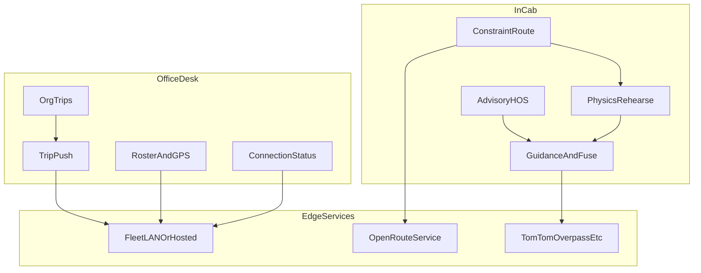
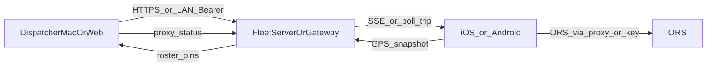

# RouteFinder — Professional Technical Writeup

**Title:** RouteFinder — A Constraint-Aware UK HGV Navigator and Fleet Desk  
**Author / owner:** Jacob Hackett  
**Document type:** Living professional technical writeup (AQA NEA–style structure; **no client interviews**)  
**Repository:** proprietary — see root [`LICENSE`](../LICENSE)  
**Last updated:** 2026-11-11  
**Status:** **iterative** — Section 1 Analysis complete; Sections 2–5 and Appendices stubbed (next attach = §2 Design)

Integers, CI evidence, and phase verification remain authoritative in [`competitive-feature-scorecard.md`](competitive-feature-scorecard.md), [`engineering-test-matrix.md`](engineering-test-matrix.md), and relevant `phase*` Docs. This document provides the formal analysis–design–implementation–testing–evaluation narrative and points at those SSOTs.

Gated product work (Android Auto / offline packs, CarPlay production entitlements, VU partner SDK, live toll £ feeds, HD lane assets, Stripe billing, further country PBF) resumes only when unlocked by name.

---

## Abstract

RouteFinder is a native multi-surface system for UK heavy goods vehicle (HGV) operators. It plans constraint-aware routes (length, width, height, weight, axle, hazmat / ADR), rehearses kinetic risk before departure, overlays advisory hours-of-service (HOS) planning, and connects in-cab drivers to an office desk over LAN or hosted HTTPS. The vehicle unit (VU) / digital tachograph remains the legal record; RouteFinder’s clocks and “Can I drive now?” answers are planning aids only.

This writeup follows a professional NEA-style structure (Analysis → Design → Implementation → Testing → Evaluation → Appendices) adapted to a production product rather than a single-client coursework brief. Stakeholder needs are derived from documented buyer personas and competitive research, not from fabricated client interviews.

---

## Document control

| Field | Value |
|-------|--------|
| Primary file | `Docs/project-writeup.md` |
| Related indexes | [`developer-map.md`](developer-map.md), root [`README.md`](../README.md) |
| Architecture SSOT | [`architecture.md`](architecture.md) |
| Competitive SSOT | [`competitive-feature-scorecard.md`](competitive-feature-scorecard.md), [`ultimate-competitive-excellence-sweep.md`](ultimate-competitive-excellence-sweep.md) |
| Fleet API contract | [`fleet-api-schema.json`](fleet-api-schema.json) |

---

## Table of contents

1. [Analysis](#1-analysis)
   - [1.1 Problem statement](#11-problem-statement)
   - [1.2 Background](#12-background)
   - [1.3 Stakeholders and personas](#13-stakeholders-and-personas)
   - [1.4 Research into the problem](#14-research-into-the-problem)
   - [1.5 Alternative solutions](#15-alternative-solutions)
   - [1.6 Objectives](#16-objectives)
   - [1.7 Modelling the problem](#17-modelling-the-problem)
   - [1.8 Requirements derivation](#18-requirements-derivation)
   - [1.9 Constraints](#19-constraints)
   - [1.10 Assumptions](#110-assumptions)
2. [Design](#2-design) *(stub)*
3. [Implementation](#3-implementation) *(stub)*
4. [Testing](#4-testing) *(stub)*
5. [Evaluation](#5-evaluation) *(stub)*
6. [Appendices](#6-appendices) *(stub)*
7. [Document changelog](#7-document-changelog)

---

## 1. Analysis

### 1.1 Problem statement

UK HGV drivers and small-fleet transport managers must plan and execute journeys under vehicle-specific constraints that consumer navigation systems routinely ignore or under-specify: low bridges, weight limits, length/width restrictions, hazmat / ADR tunnel codes, Low Emission Zones (LEZ) / Clean Air Zones (CAZ), named tolls, and legally mandated driving and rest limits under EU Regulation 561 and the Working Time Directive (WTD).

Failures of constraint-aware planning produce operational and legal risk: unsuitable roads, unexpected LEZ exposure, missed rest opportunities, inflated ETAs that do not reflect grade or kinetic reality, and office–cab disconnect when depot Wi‑Fi or LAN pairing fails. Enterprise telematics (e.g. Samsara, Geotab) emphasises compliance download and fleet tracking; dedicated truck navigators (e.g. Sygic Truck, CoPilot) emphasise maps and guidance; few systems combine **constraint routing**, **physics rehearsal**, **advisory HOS**, and a **lightweight fleet desk** that works on LAN or hosted HTTPS without becoming a multi-tenant SaaS billing product.

**Problem to solve:** design and ship a coherent product that (a) routes HGVs under explicit constraints, (b) rehearses kinetic risk and produces shareable trip documentation, (c) advises HOS without claiming VU authority, (d) supports iOS and Android C2 in-cab use plus Mac/web dispatch, and (e) remains honest about residuals that require paid partner entitlements or licensed data.

### 1.2 Background

#### Domain

Articulated and rigid HGVs operating UK long-haul and regional trunking face:

- **Physical constraints** — height, weight, length, width, axle load, hazmat classifications.
- **Spatial policy** — LEZ/CAZ charging and access rules; authored avoid polygons are a pragmatic approximation of legal cadastre.
- **Economic friction** — named tolls (e.g. M6 Toll, Dartford, Tyne, Mersey) where indicative £ advisories help commit/avoid decisions before live operator feeds exist.
- **Temporal law** — daily/weekly driving limits, breaks, fortnight and WTD ceilings; the VU is authoritative for enforcement.
- **Operational coupling** — office staff push multi-stop jobs; drivers need toast/SSE handoff, GPS snapshots for roster pins, and Connection clarity (depot identity, masked token, API meters).

#### Product thesis

RouteFinder is positioned as a **native HGV navigator and fleet desk**, not a public multi-tenant portal. Core experience:

- **In-cab** — iOS gold-standard driver app; Android C2 fleet driver on a depot-issued handset (CarPlay / Android Auto not required for pilots).
- **Office desk** — Mac/iPad dispatch plus `web-dispatch` for Windows/Linux PCs.
- **Connectivity** — `RouteFinderFleetServer` on office LAN, or Operator hosted gateway over HTTPS with org bearer tokens.
- **UK living layer** — RegCheck/DVLA plate profiles, truck POIs, LEZ/toll/layby/hazard overlays, crowd reports fused with TomTom where configured.

#### Legal posture (non-negotiable)

RouteFinder’s HOS clock, imported card remainings, and “Can I drive now?” answers are **planning aids only**. They must not be used as a substitute for the legal tachograph record or enforcement decisions. LEZ rings are authored / open-data densified approximations, not certified cadastral boundaries. Toll £ figures are named advisories, not live operator class tariffs unless a paid feed is unlocked.

### 1.3 Stakeholders and personas

No client interviews are used in this writeup. Needs are taken from the committed persona Doc [`buyer-personas-uk-hgv.md`](buyer-personas-uk-hgv.md) and from competitive scoring practice in the sweep / scorecard.

| Stakeholder | Role | Primary needs |
|-------------|------|----------------|
| Owner-operator (“Dave”) | 1 tractor; personal iPhone; high budget sensitivity | Constraint routing, break/layby guidance, LEZ awareness, voice/map at junctions, physics rehearsal, degraded-signal resilience |
| Small fleet operator (“Sarah”) | 2–20 vehicles; Mac/iPad office | Push trip with constraints, physics ETA, shareable trip brief, LAN discovery without heavy IT, optional layby prediction on active trips |
| Android-heavy fleet (secondary) | Depot Android handsets | Fleet ORS proxy (no driver HeiGIT key), MapLibre nav, SSE handoff, Connection wizard/home parity |
| Hosted-remote desk (secondary) | Depot Wi‑Fi unreliable | HTTPS gateway, named depot profiles, `/v1/proxy/status` org identity + meters |

**Deal-breakers captured from personas (honest):** routes through unsuitable village infrastructure; surprise LEZ entry; no break planning on long legs; opaque subscription with no differentiation; entitlement-gated CarPlay on personal teams; smaller offline footprint than Sygic-class Europe packs.

### 1.4 Research into the problem

Research is documentary and competitive, not interview-based.

1. **Competitive feature scoring** — [`competitive-feature-scorecard.md`](competitive-feature-scorecard.md) records Lead / Parity / Gap integers against Sygic, TomTom, CoPilot, and telematics peers, with residuals tagged to epics (`EPIC-CARPLAY-PROD`, `EPIC-ANDROID-AUTO`, `EPIC-VU-PARTNER`, `EPIC-LEZ-CADASTRE`, `EPIC-TOLL-DEPTH`, `EPIC-LANE-DEPTH`, `EPIC-HOSTED-DESK`).
2. **Excellence sweep** — [`ultimate-competitive-excellence-sweep.md`](ultimate-competitive-excellence-sweep.md) sequences agent-doable vs secrets-gated work and records shipped MVP slices (including HOSTED-DESK Connection parity and Docs honesty).
3. **Domain constraints** — EU 561 / WTD advisory behaviour; DVSA-style walkaround; GOV.UK-linked toll advisory catalogs; ORS avoid-polygon area caps (London-wide ULEZ avoid blocked at provider limits).
4. **Engineering evidence paths** — `swift test`, `web-dispatch` `npm test`, GitHub Actions `android-c1`, phase verification Docs, fleet E2E playbook.

**Findings relevant to analysis:**

- Physics rehearsal and advisory HOS+desk coupling are differentiators relative to pure truck-nav peers.
- Offline depth and production CarPlay/Android Auto remain competitor leads where RouteFinder is gated or MVP-limited.
- Hosted multi-depot **org identity + Connection meters** shipped as Account-Manager-lite; Stripe self-serve billing remains explicitly out of scope.
- Further LEZ densify / mid-corridor / toll-£ catalog clones are anti-grind unless a Mersey-class hole or measurable scorecard gap appears.

### 1.5 Alternative solutions

| Class | Examples | Strengths | Gaps vs RouteFinder thesis |
|-------|----------|-----------|----------------------------|
| Consumer maps | Apple Maps, Google Maps | Ubiquity, UX polish | Weak HGV constraint fidelity; no fleet desk; no physics rehearsal |
| Truck navigators | Sygic Truck, CoPilot, TomTom GO Truck | Offline packs, LEZ depth, AA/CarPlay maturity | Limited physics rehearsal; desk often separate or enterprise-priced; subscription friction for owner-operators |
| Fleet telematics | Samsara, Geotab | VU/compliance download, tracking | Navigation/physics not core; heavier IT footprint |
| Open routing stacks | ORS + OSM tooling, GraphHopper | Transparent constraints API | Not a full cab+desk product; no HOS/walkaround/dispatch UX |
| Educational / research routers | Student Dijkstra/A* GUIs | Algorithm pedagogy | Not production multi-surface fleet systems |

**Conclusion:** Build a focused native product that uses ORS (and hybrid offline where shipped) for constraint routing, adds physics + advisory compliance + desk sync, and documents gated gaps honestly rather than claiming enterprise VU or licensed cadastre parity.

### 1.6 Objectives

#### 1.6.1 Functional objectives (FO)

| ID | Objective | Surface evidence (shipped MVP unless noted) |
|----|-----------|-----------------------------------------------|
| FO1 | Plan HGV routes under length/width/height/weight/axle/hazmat/ADR constraints | ORS via planning stack; trailer→ORS length ladder on cab/desk |
| FO2 | Support multi-stop jobs and office→driver trip push | Fleet server + Mac/web dispatch; SSE/toast handoff |
| FO3 | Rehearse kinetic risk and export trip brief (text/PDF) | Physics / rehearsal engines; shareable brief |
| FO4 | Advise HOS (561/WTD) and Can-I-drive day/week without claiming VU authority | HOS advisory modules; desk week cards; legal disclaimer |
| FO5 | Provide UK living-layer advisories (LEZ, tolls, laybys, hazards, plate profile) | Catalogs + HUD/TTS/desk indicative £; RegCheck/DVLA when configured |
| FO6 | Operate desk+driver on LAN or hosted HTTPS with clear Connection status | Fleet server / hosted-gateway; `/v1/proxy/status` orgId/orgName + meters on web/Mac/Android |
| FO7 | Ship Android C2 fleet driver as ORS-proxy thin client | `android-fleet-driver/`; [`android-c2-gate.md`](android-c2-gate.md) |
| FO8 | Enrich lane/street guidance via OSM Overpass within caps | Overpass ≤12/route; residual HD visuals gated |

#### 1.6.2 Non-functional objectives (NFO)

| ID | Objective | Approach |
|----|-----------|----------|
| NFO1 | Modular architecture; no HTTP from Views | Swift package modules + coordinators ([`architecture.md`](architecture.md)) |
| NFO2 | Strict concurrency / async I/O | Swift 5.9+ / Swift 6 package norms; actors for shared mutable state |
| NFO3 | Consistent glass UI | `GlassmorphicModifiers` on SwiftUI chrome |
| NFO4 | Secrets hygiene | No committed API keys; mask tokens in UI and screenshots |
| NFO5 | Remote reliability | `RemoteRequestPolicy` timeouts/retries/429 handling |
| NFO6 | Verifiability | Unit/CI gates (`swift test`, `npm test`, `android-c1`) + phase Docs |
| NFO7 | Honest Docs SSOT | Scorecard/sweep/writeup updated when surfaces ship |

#### 1.6.3 Measurable success criteria

| Criterion | Measurement |
|-----------|-------------|
| Constraint route returns usable geometry for valid HGV profile | Automated routing/planning tests + manual stranger path in [`getting-started.md`](getting-started.md) |
| Trip push visible on paired driver | Fleet E2E / LAN checklist [`fleet-e2e-qa.md`](fleet-e2e-qa.md) |
| Proxy status shows depot identity + meters on Connection Test | Greppable UI parity (web `maskApiKey`, Mac Settings/Wizard, Android wizard/home) |
| CI green for package + web + Android job | `.github/workflows/ci.yml` |
| Legal disclaimer present for HOS | README + in-product advisory copy |
| Residuals labelled, not claimed Shipped | Scorecard Gated/Residual rows |

#### 1.6.4 Objective validation criteria

An FO is **validated** when: (1) greppable implementation exists on the claimed surface(s); (2) automated tests or a named phase/CI job cover the critical path where applicable; (3) Docs (scorecard or gate Doc) mark Shipped (MVP) vs Residual without contradiction. An NFO is validated by architecture rules, CI, and Docs honesty checks in the same PR week as surface changes.

### 1.7 Modelling the problem

#### 1.7.0 Problem decomposition

#### 1.7.1 Routing / graph model

Production routing for live HGV plans is primarily **ORS-backed** with vehicle profile parameters. Offline / hybrid pathfinding uses in-package graph tiles (H3) and cost models where downloaded — see module graph in [`architecture.md`](architecture.md) (`GraphCore`, `CostModel`, `PathfindingEngine`). This writeup does not equate the product to a single educational Dijkstra/A* CSV graph; those algorithms may appear inside offline engines but the operator-facing contract is constraint-aware route requests + rehearsal + desk sync.

#### 1.7.2 Surface / deployment model

| Node | Responsibility |
|------|----------------|
| iOS / Mac app | UI, coordinators, local rehearsal, fleet client |
| Android C2 | Kotlin thin client; fleet proxy routing; MapLibre |
| `web-dispatch` | React desk; Connection profiles; roster; indicative tolls; layby card |
| Fleet server | LAN `/v1/*`, Bearer auth, fair-use, push |
| Hosted gateway | HTTPS Operator deployment of the same API family |
| External APIs | ORS, TomTom, Overpass, RegCheck/DVLA, OpenWeather (when configured) |

#### 1.7.3 Level-0 data flow (desk ↔ driver)

#### 1.7.4 Summary

The system is modelled as coordinated cab and desk clients sharing a fleet API, with routing and live enrichment as external services, and with legal/compliance boundaries enforced in product copy and residual labelling.

### 1.8 Requirements derivation

Requirements are derived by intersecting:

1. Persona jobs-to-be-done (constraint route, breaks, LEZ, push trip, physics ETA, Connection clarity).
2. Competitive gaps that are agent-doable without inventing secrets-gated epics.
3. Hard engineering rules (glass UI, concurrency, secrets, Docs honesty).

Each FO in §1.6 traces to at least one persona job and one verification path. Residuals that need Apple entitlements, VU partner SDKs, Stripe, or licensed live tariffs are recorded as **constraints** (§1.9), not as silently deferred FOs.

### 1.9 Constraints

| Constraint | Impact |
|------------|--------|
| Proprietary codebase / no public redistribution without agreement | Documentation may link paths but must not leak secrets |
| HeiGIT ORS avoid-polygon area caps | London-wide ULEZ avoid not shippable as unbounded polygon |
| Personal vs paid Apple Developer team | CarPlay production entitlements inactive until paid team |
| Android Auto / deep offline packs | Product-gated per [`android-c2-gate.md`](android-c2-gate.md) |
| No VU partner SDK in-session | Legal remote VU download residual |
| No Stripe keys / billing product scope | Hosted desk stops at Account-Manager-lite |
| Anti-grind policy | No mid-corridor / LEZ densify / toll-£ clones without measurable gap or catalog hole |
| Fair-use API metering | Soft budgets / ledger; meters exposed on proxy status |

### 1.10 Assumptions

1. Operators can obtain ORS (and optional TomTom/OpenWeather) credentials or use fleet proxy keys configured by the depot — drivers on fleet mode do not need personal HeiGIT keys.
2. LAN or hosted Connectivity is available for desk↔driver push; solo drivers may use on-device ORS keys.
3. Authored LEZ rings and named toll advisories are acceptable for MVP with clear non-legal / non-live labelling.
4. CI on GitHub Actions plus local `swift test` / `npm test` is sufficient automated evidence for ungated surfaces; physical device smoke remains optional via phase checklists.
5. Persona Docs remain a valid substitute for client interviews for analysis and prioritisation in this writeup.
6. Future gated unlocks will be named explicitly before implementation rather than inferred.

---

## 2. Design

*(Stub — fill next attach. Target subsections:)*

### 2.1 Design goals / rationale
- Modular OOP / SPM boundaries; strategy-like routing clients; centralised cost/constraints; layered architecture; accessible UI; extensibility.
- Technology selection: Swift 6 + SwiftUI + MapLibre; Kotlin Android C2; Vite/React desk; Workers/VPS gateway.
- Pointers: [`architecture.md`](architecture.md), root README tech stack.

### 2.2 System architecture
- Expand module dependency + coordinator + desk↔driver diagrams from architecture Doc.
- Error handling / reliability (`RemoteRequestPolicy`); extensibility points (proxy providers, catalogs).

### 2.3 Data / class design
- Core models: vehicle profile, trip/job brief, proxy status (`FleetProxyDeskStatus`), HOS state, risk advisory.
- Rationale mapping to FOs.

### 2.4 Algorithm / planning design
- ORS request shaping; hybrid offline pathfinding overview; predictive risk fuse; LEZ avoid polygons; toll advisory matching — complexity and failure modes at product level (not NEA CSV Dijkstra prose unless citing offline engine).

### 2.5 Interface design
- Glassmorphic SwiftUI; web-dispatch Connection; Android wizard/home; accessibility notes.

### 2.6 Data dictionary
- Key fields: orgId/orgName, meters, vehicle dimensions, duty state, predictedLayby, corridor toll advisories.

### 2.7 Objective traceability matrix
- FO/NFO → design component → implementation path (seed in Appendix A; complete in Design PR).

---

## 3. Implementation

*(Stub — fill after §2.)*

### 3.1 Implementation overview
- File/module responsibility mapping across `RouteFinder/`, app project, `web-dispatch/`, `android-fleet-driver/`, `hosted-gateway/`.

### 3.2 Graph / routing implementation
- ORS client; offline tiles policy; trailer length ladder.

### 3.3 Route planning / coordinators
- `RoutePlanningCoordinator`, search mapping, recalculate debounce.

### 3.4 Pathfinding / offline engines
- Where `PathfindingEngine` / cost model apply.

### 3.5 Cost model, preferences, vehicle constraints
- Avoid toggles (LEZ, tolls); hazmat/ADR.

### 3.6 Multi-stop / fleet dispatch
- Job brief, push, SSE, snapshots.

### 3.7 UI implementation by surface
- iOS/Mac glass; web desk; Android Compose screens.

### 3.8 Error handling and robustness
- Remote policy; user-visible banners; masked tokens.

### 3.9 Automated testing integration
- SPM tests; web smoke; Android unit tests; CI jobs.

### 3.10 Objective fulfilment confirmation
- Table FO → symbol/path → Doc status.

---

## 4. Testing

*(Stub — fill after §3.)*

### 4.1 Testing strategy
- Unit + integration + CI; optional physical smoke ([`phase1-device-checklist.md`](phase1-device-checklist.md)).

### 4.2 Unit testing
- `cd RouteFinder && swift test`; Android Gradle unit tests (JDK 17–22).

### 4.3 Routing / algorithm testing
- Constraint and planning cases; offline where present.

### 4.4 Cost model and constraint testing
- LEZ avoid, toll advisory catalogs, trailer ladder.

### 4.5 Edge case and robustness testing
- Invalid geocode, proxy failure, missing keys banners.

### 4.6 Performance / fair-use
- Metering ledger; proxy status meters.

### 4.7 Test evidence
- CI links; phase verification Docs; screenshot index.

### 4.8 Objective verification table
- Cross-reference FO/NFO to tests.

---

## 5. Evaluation

*(Stub — fill after §4. **Developer-led only — no client evaluation method.**)*

### 5.1 Method of developer evaluation
- Compare shipped surfaces to FO/NFO and scorecard; cite CI/phase evidence.

### 5.2 Comparison against original objectives
- Met / partial / gated table.

### 5.3 Limitations
- Entitlements, cadastre, live £, VU download, HD lanes, Stripe, Android offline.

### 5.4 Maintenance and future work
- Unlock-gated epics; writeup section completion order.

---

## 6. Appendices

*(Stub — polish after §5.)*

### Appendix A — Objectives traceability seed
- Maintain FO/NFO IDs; fill design/impl/test columns as sections land.

### Appendix B — Document index
- developer-map, getting-started, architecture, scorecard, sweep, fleet-api-schema, hosted-gateway-deployment, android-c2-gate, pilot-fleet-pack.

### Appendix C — Screenshots
- [`screenshots/README.md`](screenshots/README.md) (masked secrets).

### Appendix D — Data sources
- ORS, OSM/Overpass, TomTom, RegCheck/DVLA, OpenWeather — licences and configuration notes from README.

### Appendix E — Glossary
- HGV, LEZ/CAZ, ORS, HOS, VU, SSE, Account-Manager-lite, Anti-grind.

---

## 7. Document changelog

| Date | PR / issue | Change |
|------|------------|--------|
| 2026-11-11 | #125 / #126 | Initial living narrative Ch 1–3 |
| 2026-11-11 | #127 / #128 | Narrative Ch 4 (routing / UK layer / compliance) |
| 2026-11-11 | #129 / (this PR) | Restructure to NEA-style; **Section 1 Analysis complete**; §§2–5 + Appendices stubbed |
