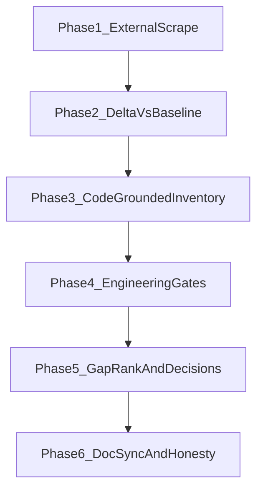

# Ultimate competitive excellence sweep

**Track:** Competitive intel + engineering truth (no legal/GTM pricing).  
**Cadence:** Quarterly (or early when tooling/access improves).  
**Last run:** 2026-10-12  
**Baseline docs:** `[competitive-research-2026-08.md](competitive-research-2026-08.md)`, `[competitive-feature-scorecard.md](competitive-feature-scorecard.md)`, `[competitive-gap-matrix.md](competitive-gap-matrix.md)`, `[engineering-benchmark-2026-09.md](engineering-benchmark-2026-09.md)`.

This runbook is the repeatable procedure. Each execution appends a dated **Execution report** below.

---


## Explicit out of scope

Nothing is out of scope if it's: not in the market, could be used to benefit the driver in any way possible, simplifies their job, enhances the program.

---


## Phases




### Phase 1 — External scrape (Firecrawl primary)

Archive to `.firecrawl/` (gitignored). Prefer concurrent scrapes with `--only-main-content`.


| Slug               | URL                                                                                                                                                                                                                                                                                                                            |
| ------------------ | ------------------------------------------------------------------------------------------------------------------------------------------------------------------------------------------------------------------------------------------------------------------------------------------------------------------------------ |
| `sygic-truck`      | [https://www.sygic.com/truck](https://www.sygic.com/truck)                                                                                                                                                                                                                                                                     |
| `sygic-lez`        | [https://www.sygic.com/what-is/low-emission-zones](https://www.sygic.com/what-is/low-emission-zones)                                                                                                                                                                                                                           |
| `sygic-carplay-aa` | [https://help.sygic.com/hc/en-us/articles/38176591980434-Android-Auto-Apple-CarPlay-in-Sygic-Truck-Caravan-Navigation](https://help.sygic.com/hc/en-us/articles/38176591980434-Android-Auto-Apple-CarPlay-in-Sygic-Truck-Caravan-Navigation)                                                                                   |
| `tomtom-go-pro`    | [https://www.tomtom.com/en_gb/navigation/truck-gps-sat-nav/go-professional/](https://www.tomtom.com/en_gb/navigation/truck-gps-sat-nav/go-professional/)                                                                                                                                                                       |
| `copilot-product`  | [https://transportation.trimble.com/en/solutions/mapping-and-routing/copilot](https://transportation.trimble.com/en/solutions/mapping-and-routing/copilot)                                                                                                                                                                     |
| `copilot-11-intro` | [https://developer.trimblemaps.com/copilot-navigation/release-notes/introduction-copilot-11/](https://developer.trimblemaps.com/copilot-navigation/release-notes/introduction-copilot-11/)                                                                                                                                     |
| `copilot-upgrade`  | [https://developer.trimblemaps.com/copilot-navigation/release-notes/upgrade-copilot/](https://developer.trimblemaps.com/copilot-navigation/release-notes/upgrade-copilot/)                                                                                                                                                     |
| `copilot-11-0`     | [https://developer.trimblemaps.com/copilot-navigation/release-notes/v11_0/](https://developer.trimblemaps.com/copilot-navigation/release-notes/v11_0/)                                                                                                                                                                         |
| `garmin-dezl`      | [https://www.garmin.com/en-US/newsroom/press-release/automotive/garmin-introduces-refreshed-dezl-otr-navigator-series-with-insights-from-fellow-truck-drivers/](https://www.garmin.com/en-US/newsroom/press-release/automotive/garmin-introduces-refreshed-dezl-otr-navigator-series-with-insights-from-fellow-truck-drivers/) |
| `ptv-navigator`    | [https://www.ptvlogistics.com/en-us/products/ptv-navigator/features](https://www.ptvlogistics.com/en-us/products/ptv-navigator/features)                                                                                                                                                                                       |
| `here-pro-nav`     | [https://www.here.com/solutions/professional-navigation](https://www.here.com/solutions/professional-navigation)                                                                                                                                                                                                               |
| `samsara-tacho`    | [https://www.samsara.com/uk/products/telematics/tachograph](https://www.samsara.com/uk/products/telematics/tachograph)                                                                                                                                                                                                         |
| `geotab-tacho`     | [https://www.geotab.com/uk/fleet-management-solutions/smart-digital-tachograph/](https://www.geotab.com/uk/fleet-management-solutions/smart-digital-tachograph/)                                                                                                                                                               |
| `travis-trimble`   | [https://www.yourtravis.com/knowledge/trimble-integration/](https://www.yourtravis.com/knowledge/trimble-integration/)                                                                                                                                                                                                         |


```bash
mkdir -p .firecrawl
npx firecrawl-cli login --browser   # once per machine
npx firecrawl-cli scrape "<url>" --only-main-content -o .firecrawl/<slug>.md
# Or batch URLs; Firecrawl free tier ~10–15 req/min — pause between batches
```

**Fallback:** Apify `apify--web-fetch` / `apify--rag-web-browser` for JS-heavy pages or rate limits.  
**Tertiary:** Cursor WebSearch for release-note version pins when scrape is thin.

### Phase 2 — Delta vs baseline

Build a table: *Source | Prior claim | Current claim | RF impact (none / narrative / score)*.  
Do **not** invent competitor features from marketing fluff without a concrete public claim.

### Phase 3 — Code-grounded inventory

Validate scorecard **Lead** and contested **Parity** rows against shipped symbols:


| Theme                  | Evidence                                                                      |
| ---------------------- | ----------------------------------------------------------------------------- |
| Physics rehearsal      | `KineticPhysicsEngine`, `RouteSimulationCoordinator`, `RouteSimulationEngine` |
| Predictive fuse        | `RouteRiskAdvisory`, `PredictiveRiskCoordinator`                              |
| Fleet dispatch / proxy | `FleetSSEClient`, fleet server, `web-dispatch/`, `hosted-gateway/`            |
| Android parity         | `android-fleet-driver/`, `[android-c2-gate.md](android-c2-gate.md)`           |
| Lane / LEZ / offline   | `LaneGuidanceEnricher`, `LEZAvoidPolicy`, `OfflineMapPackStore`               |


### Phase 4 — Engineering gates


| Gate           | Command                                                                                             |
| -------------- | --------------------------------------------------------------------------------------------------- |
| Swift package  | `cd RouteFinder && swift test`                                                                      |
| Fleet LAN      | `bash RouteFinder/Scripts/fleet-e2e-smoke.sh`                                                       |
| Web dispatch   | `cd web-dispatch && npm ci && npm test && npm run build`                                            |
| Hosted gateway | `cd hosted-gateway && npm ci && npm test && npm run typecheck`                                      |
| Android C1     | `JAVA_HOME=<JDK 17–22> ./gradlew :app:testDebugUnitTest :app:assembleDebug` (OpenJDK 25 breaks AGP) |
| CI truth       | `gh run list --limit 5` on `main`                                                                   |


Device rows (C4 / C9 / CarPlay / Fleet Part B) stay **Blocked — operator** unless hardware is available in-session.

### Phase 5 — Gap rank and decisions

Formula (driver-first): `(competitor best − RF) × persona weight × driver_impact`.  
Feasibility is annotated (partner / entitlement / data cost) but is **not** a hard veto when the capability helps the cab driver.  
Output: hygiene unblockers first, then a **ranked build backlog** (sequenced later ≠ won’t chase).

### Phase 6 — Doc sync

Update research appendix, scorecard `Last updated`, gap matrix backlog, `[phase20-verification.md](phase20-verification.md)` ledger, and cross-links. Pricing stays in `[competitor-pricing-2026.md](competitor-pricing-2026.md)` only.

---


## Acceptance criteria

- [x] Runbook + dated execution report present
- [x] `.firecrawl/` populated locally; delta table complete (even if “no material deltas”)
- [x] Scorecard / matrix / research / phase20 dates consistent; no false parity claims
- [x] Engineering gates recorded
- [x] Ranked recommendations (driver-first; sequenced later allowed)
- [x] Tooling recommendations section present
- [x] Driver-first reopen applied (hard deferrals removed; sequenced gaps in scorecard/matrix)

---


## Tooling recommendations (ongoing)

**Use heavily (available):** Firecrawl CLI, Apify web-fetch/RAG, Context7 for API docs, `gh` for CI, optional `cursor-subscriptions` CI watch.

**High leverage to add:**


| Gap                    | Suggestion                                                        | Why                                                                                                 |
| ---------------------- | ----------------------------------------------------------------- | --------------------------------------------------------------------------------------------------- |
| Dependency hygiene     | Dependabot / Renovate                                             | Multi-stack; no `dependabot.yml` today                                                              |
| Android confidence     | Maestro or Gradle managed devices in CI; pin JDK 17–22 in docs/CI | Local OpenJDK 25 breaks AGP (`IllegalArgumentException: 25.0.2`); CI `android-c1` failing on `main` |
| iOS pilot distribution | fastlane (TestFlight)                                             | Reduces manual archive friction                                                                     |
| Fleet load / SSE       | k6 against `RouteFinderFleetServer`                               | Prove 5–15 phone demo claims                                                                        |
| Swift hygiene          | SwiftLint / Periphery in CI                                       | Automate zero-warning budget                                                                        |
| Web E2E                | Playwright for `web-dispatch` push→preview                        | Guard map-preview stability                                                                         |
| Schema contract        | OpenAPI diff on `fleet-api-schema.json`                           | Catch iOS/Android/web breakages                                                                     |
| Competitive monitors   | Firecrawl `monitor` on CoPilot upgrade notes + Sygic truck        | Catch mid-quarter deltas without full re-scrape                                                     |


---


## Execution report — 2026-10-12

**Status:** Complete  
**Scope:** Full quarterly competitive re-scrape (early vs Ph30+ target 2026-11) + code-grounded scorecard audit + engineering gates + doc sync.

### Tools used

- Firecrawl CLI v1.26.3 (authenticated; primary scrape; rate-limit pause between batches)
- Apify `apify--web-fetch` (parallel first wave while Firecrawl login completed)
- WebSearch (CoPilot 11.4 version pin confirmation)
- Local `swift test`, fleet smoke, web/android/hosted npm/gradle
- `gh run list` / `gh run view` for CI truth


### Phase 1 — Scrape status


| Slug             | Status | Notes                                       |
| ---------------- | ------ | ------------------------------------------- |
| sygic-truck      | **OK** | Firecrawl → `.firecrawl/sygic.com-truck.md` |
| sygic-lez        | **OK** | Firecrawl                                   |
| sygic-carplay-aa | **OK** | Paid add-on confirmed unchanged             |
| tomtom-go-pro    | **OK** | Firecrawl + Apify                           |
| copilot-product  | **OK** | Firecrawl                                   |
| copilot-11-intro | **OK** | Firecrawl                                   |
| copilot-upgrade  | **OK** | **Material:** CoPilot **11.4** (Aug 2026)   |
| copilot-11-0     | **OK** | Firecrawl (after rate-limit retry)          |
| garmin-dezl      | **OK** | Firecrawl (retry)                           |
| ptv-navigator    | **OK** | Firecrawl                                   |
| here-pro-nav     | **OK** | Firecrawl (retry)                           |
| samsara-tacho    | **OK** | Firecrawl                                   |
| geotab-tacho     | **OK** | Firecrawl (retry)                           |
| travis-trimble   | **OK** | Still Jul 23 2026; 750+ EU sites            |


### Phase 2 — Competitor delta table


| Source                       | Aug 2026 claim                                                         | Oct 2026 claim                                                                                                                                                                                                                                                                                                                      | RF impact                                                                                                                                                                      |
| ---------------------------- | ---------------------------------------------------------------------- | ----------------------------------------------------------------------------------------------------------------------------------------------------------------------------------------------------------------------------------------------------------------------------------------------------------------------------------- | ------------------------------------------------------------------------------------------------------------------------------------------------------------------------------ |
| **CoPilot upgrade notes**    | 11.3 Break Now default-on; Book Parking EU select; TRAVIS redirect     | **11.4** (Aug 2026): Driver Assistant AI voice; street-name callouts; bumper-to-bumper length + trailer count (**NA only**); highway % trip preview (**NA**); color-coded parking availability icons; EU speed-limit/camera display redesign; mute default; enhanced HOS sync (**US/ELD**); Android Auto speed/traffic bar defaults | **Score later** — reopen as sequenced epics under driver-first policy (voice, AA, length dims, parking UX). No physics rehearsal from CoPilot; layby integer stays **3**. |
| **TRAVIS × Trimble**         | 750+ sites / 26 countries; booking redirect                            | Unchanged (same Jul 23 2026 press)                                                                                                                                                                                                                                                                                                  | **Score later** — booking / in-flow reserve sequenced (`EPIC-PARKING-BOOK`)                                                                                              |
| **Sygic Truck**              | Offline truck maps; LEZ Euro profile + reroute; CarPlay/AA paid add-on | Same public claims; LEZ glossary + CarPlay help confirm add-on model                                                                                                                                                                                                                                                                | **Score later** — CarPlay/AA + offline depth sequenced                                                                                                                   |
| **TomTom GO Professional**   | Hardware L/W/H, ADR, moving lane guidance, Traffic                     | Same 2nd-gen GO Professional positioning; lane guidance still hardware strength                                                                                                                                                                                                                                                     | **Score later** — lane HD + toll depth sequenced                                                                                                                         |
| **Garmin dēzl / PTV / HERE** | Community parking / enterprise nav / platform                          | No UK-ICP-changing deltas in scrape                                                                                                                                                                                                                                                                                                 | **none** this cycle                                                                                                                                                      |
| **Samsara / Geotab**         | Remote VU / tacho                                                      | Partner boundary unchanged                                                                                                                                                                                                                                                                                                          | **Score later** — partner VU path sequenced (`EPIC-VU-PARTNER`)                                                                                                          |


**Scorecard integers (Oct 12 scrape):** no OO/SF row changes yet. Driver-first reopen (same day) sequences previously deferred gaps as build backlog below — hygiene still ahead of feature chase.

### Phase 3 — Code inventory


| Theme                  | Verified? | Notes                                                                                                                                                                                |
| ---------------------- | --------- | ------------------------------------------------------------------------------------------------------------------------------------------------------------------------------------ |
| Physics rehearsal      | **Yes**   | `KineticPhysicsEngine`, `RouteSimulationCoordinator`, `RouteSimulationEngine` present. WIP in working tree (geometry / physics actor). **Lead claim stays**; see gate failure below. |
| Predictive fuse        | **Yes**   | `RouteRiskAdvisory`, `PredictiveRiskCoordinator`, `predictiveRiskPrimaryBanner`                                                                                                      |
| Break Now / layby      | **Yes**   | `LaybyPredictionEngine` Break Now path; Settings toggle; mirrors CoPilot 11.3 UX without booking                                                                                     |
| Fleet dispatch / proxy | **Yes**   | `FleetSSEClient`; fleet smoke 14/14; web-dispatch + hosted-gateway green                                                                                                             |
| Lane / LEZ / offline   | **Yes**   | `LaneGuidanceEnricher`, `spokenLanePhrase`, `LEZAvoidPolicy`, `OfflineMapPackStore`                                                                                                  |
| Android U11–U15        | **Yes**   | `LezAvoidPolicy`, `ForecastRiskSampler`, `ClearanceCorridorProbe`, RegCheck wizard, walkaround — unit tests + `assembleDebug` Pass (JDK 22)                                          |
| Parking partners       | **Yes**   | `ParkingPartnerLinks` TRAVIS/SNAP deep links only                                                                                                                                    |


### Phase 4 — Engineering gates


| Gate                              | Result                                                                                                                                                                                                                        |
| --------------------------------- | ----------------------------------------------------------------------------------------------------------------------------------------------------------------------------------------------------------------------------- |
| `swift test`                      | **Partial fail** — UITests `spineSpeedLimitAcceleratesToMotorwayLimit` (expect `activeLegalSpeedLimitKmh == 112`, `peakSpeedKmh >= 105`). Other suites green. Treat as **simulation WIP debt**, not competitive score change. |
| Fleet E2E smoke                   | **Pass** — 14/14 filters                                                                                                                                                                                                      |
| web-dispatch                      | **Pass** — smoke + production build                                                                                                                                                                                           |
| hosted-gateway                    | **Pass** — 8 vitest + typecheck                                                                                                                                                                                               |
| Android C1                        | **Pass** with `JAVA_HOME=…/jdk-22.jdk` — **Fail** on default Homebrew OpenJDK **25.0.2** (`IllegalArgumentException: 25.0.2`)                                                                                                 |
| CI `main` (run `36718254358`)     | macos/ios/web/hosted **success**; **android-c1 failure** — investigate separately                                                                                                                                             |
| Device C4 / C9 / Part B / CarPlay | **Blocked — operator** (unchanged)                                                                                                                                                                                            |


### Phase 5 — Recommendations (superseded by driver-first reopen below)

Original Oct 12 “Defer” list is **void** under the driver-first scope rule. Hygiene items remain immediate.

### Doc sync checklist

- [x] This execution report complete
- [x] `[competitive-research-2026-08.md](competitive-research-2026-08.md)` Oct appendix
- [x] `[competitive-feature-scorecard.md](competitive-feature-scorecard.md)` date + notes
- [x] `[competitive-gap-matrix.md](competitive-gap-matrix.md)` Ph30+ Done
- [x] `[phase20-verification.md](phase20-verification.md)` ledger row
- [x] README + ultimate-hgv cross-link
- [x] Driver-first reopen (2026-10-12b) — Phase 5 + scorecard/matrix sequenced gaps

---

## Driver-first reopen — 2026-10-12b

**Policy:** Nothing is out of scope if it is not in market yet, benefits the driver, simplifies the job, or enhances the program.  
**Scrape basis:** Oct 12 Firecrawl pack (no re-scrape).  
**Formula:** `(competitor best − RF) × persona weight × driver_impact` — feasibility annotated, not vetoed.

### Immediate hygiene (ahead of feature chase)

| Rank | Epic / work | Why first | First slice |
|------|-------------|-----------|-------------|
| H1 | `EPIC-SIM-SPEEDLIMIT` | Physics Lead must stay CI-honest | Restore `spineSpeedLimitAcceleratesToMotorwayLimit` |
| H2 | `EPIC-ANDROID-JDK-CI` | `android-c1` red on `main`; OpenJDK 25 breaks AGP | Pin JDK 17–22 in docs/CI; green assemble + unit tests |
| H3 | `EPIC-P0-DEVICE` | Demo claims need hardware truth | Operator C4 / C9 / Fleet Part B |

### Ranked driver-first build backlog

| Rank | Epic ID | Driver benefit | Competitor signal | Feasibility note | First slice |
|------|---------|----------------|-------------------|------------------|-------------|
| 1 | `EPIC-VOICE-ASSIST` | Hands-free rest / trip / mute / feedback without leaving nav | CoPilot 11.4 Driver Assistant | On-device + domain intents first; no general LLM required for MVP | Voice intents: Break Now, next layby, mute, “where am I stopping?” |
| 2 | `EPIC-PARKING-AVAIL` | See ample / limited / none at truck stops before diverting | CoPilot 11.4 color parking icons + RF occupancy taps | Fuse crowd taps + partner availability APIs when keys exist | Color icons on ahead POIs + Break Now candidates |
| 3 | `EPIC-PARKING-BOOK` | Reserve a legal rest bay instead of circling | TRAVIS × CoPilot booking redirect | Partner redirect → deep book URL with return-to-nav; later native if API | TRAVIS/SNAP book deep-link from ranked layby card |
| 4 | `EPIC-CARPLAY-PROD` | Eyes-up TBT on tractor screens | Sygic paid CarPlay; CoPilot CarPlay/AA | Paid Apple team + head-unit QA | Entitlement restore + [`phase5-carplay-verification.md`](phase5-carplay-verification.md) |
| 5 | `EPIC-ANDROID-AUTO` | Same for Android cabs | CoPilot AA enhancements (11.4) | Android Auto app checklist + fleet driver parity | AA nav surface for `android-fleet-driver` |
| 6 | `EPIC-COMBO-LENGTH` | Correct routing for artic / drawbar total length | CoPilot 11.4 bumper-to-bumper + trailer count (NA maps) | UK ORS/profile fields: overall length + trailer count → constraint | Vehicle profile UI + ORS length mapping |
| 7 | `EPIC-LANE-DEPTH` | Fewer missed exits at complex junctions | TomTom / Sygic HD lanes | OSM + Overpass depth; street-name callouts like CoPilot 11.4 | Callouts on prepare/execute + richer `turn:lanes` |
| 8 | `EPIC-TOLL-DEPTH` | Know toll cost / avoid before committing | TomTom / PTV tariffs | Authored UK tariffs → live feed when affordable | Expand `UKTollAdvisoryCatalog` with £ hints |
| 9 | `EPIC-VU-PARTNER` | True remaining drive time from the legal VU | Samsara / Geotab remote VU | Partner SDK / webhook; keep advisory honest | Read-only VU status card + Can-I-drive fuse |
| 10 | `EPIC-LEZ-CADASTRE` | Fewer false LEZ hits / misses | Sygic / TomTom legal zones | Licensed polygons or OS-derived rings | Replace circle envelopes with cadastral-grade UK rings |
| 11 | `EPIC-HOSTED-DESK` | Desk pushes trips without LAN when depot Wi‑Fi fails | CoPilot Account Manager | Hosted gateway already exists | Billing/token UX + multi-depot roster for remote desk |

**Sequenced later ≠ won’t ship.** Hygiene H1–H3 land before epic rank 1+ unless a pilot forces otherwise.

---

## Agent delivery protocol (mandatory end of every output)

Every agent completion under this programme ends with these four blocks, in order:

### 1. What’s next

Ordered list of the next epic(s) (e.g. H1 sim fix → H2 Android JDK → H3 device P0 → `EPIC-VOICE-ASSIST`). State whether the agent can do it alone or needs the operator.

### 2. Your involvement (if any)

Exact steps, times, and **when to take screenshots** (see [Operator playbook](#operator-playbook--exact-instructions)). Include the paste-back template for Pass/Fail.

### 3. Commit commands

Ready-to-run block (agent fills paths/message; operator runs if the agent did not already commit on request):

```bash
cd /Users/admin/Developer/RouteFinder
git status
git add Docs/ultimate-competitive-excellence-sweep.md \
  Docs/competitive-feature-scorecard.md \
  Docs/competitive-gap-matrix.md \
  Docs/competitive-research-2026-08.md \
  Docs/phase20-verification.md \
  Docs/ultimate-hgv-platform-spec.md \
  README.md
git commit -m "$(cat <<'EOF'
Document driver-first competitive reopen and operator delivery protocol.

EOF
)"
git status
```

### 4. Push commands

```bash
cd /Users/admin/Developer/RouteFinder
git push -u origin HEAD
```

Always **print** push commands. Do **not** push unless the user asked to push (or the active plan todo explicitly includes push).

---

## What’s next after driver-first reopen

| Order | Who | Work |
|------:|-----|------|
| 1 | Agent | `EPIC-SIM-SPEEDLIMIT` — fix `spineSpeedLimitAcceleratesToMotorwayLimit` |
| 2 | Agent | `EPIC-ANDROID-JDK-CI` — pin JDK 17–22; clear CI `android-c1` |
| 3 | **Operator** | `EPIC-P0-DEVICE` — physical C4 / C9 / Fleet Part B (playbook below) |
| 4 | Agent | Start `EPIC-VOICE-ASSIST` after H1–H2 green (H3 can run in parallel if phone available) |

Also see: [`phase1-device-checklist.md`](phase1-device-checklist.md), [`fleet-e2e-qa.md`](fleet-e2e-qa.md).

---

## Operator playbook — exact instructions

Budget ~30 minutes. Same Wi‑Fi for Mac + iPhone. Mirrors [`phase1-device-checklist.md`](phase1-device-checklist.md) and [`fleet-e2e-qa.md`](fleet-e2e-qa.md).

### Prep (2 min) — no screenshot yet

1. Unlock physical iPhone; plug in if battery low.
2. Mac + iPhone on **same Wi‑Fi**.
3. In Terminal:

```bash
export ORS_API_KEY="your-heigit-key"
export FLEET_API_KEY="your-shared-secret"
```

4. Xcode: scheme `RouteFinderApp` → your iPhone → Run (signed).

### Screenshot rule

- Take a screenshot **only** at steps marked **SCREENSHOT**.
- Name files: `p0-c4-layby-voice.png`, `p0-c9-tomtom-hazard.png`, `p0-partb-toast.png`, `p0-partb-defect-card.png`.
- Drop them in chat or `Docs/qa-screenshots/` (local; do not commit secrets or API keys).

### Step A — Fleet server + desk (8 min)

```bash
cd /Users/admin/Developer/RouteFinder/RouteFinder
swift run RouteFinderFleetServer --port 8080 --ors-key "$ORS_API_KEY" --api-key "$FLEET_API_KEY"
```

Second terminal:

```bash
cd /Users/admin/Developer/RouteFinder/web-dispatch && npm run dev
```

1. Open http://127.0.0.1:5173 → Bearer = `$FLEET_API_KEY` → Connected.
2. **Bootstrap demo fleet** → Push Norwich → King's Lynn.
3. **SCREENSHOT** (optional): web-dispatch Connected + vehicle selected.

### Step B — iPhone pair (7 min)

1. Launch RouteFinderApp → HGV → Fleet setup wizard.
2. Discover LAN / paste `http://<mac-lan-ip>:8080` → same Fleet API key → Scan QR.
3. Confirm no personal HeiGIT nag when ORS proxy is on.

### Step C — Fleet Part B (push → toast → walkaround → desk)

1. Push trip from web-dispatch.
2. **SCREENSHOT:** iPhone **Trip received** toast (within ~10 s) → `p0-partb-toast.png`.
3. Find route / Rehearse if needed → Start nav briefly.
4. On **iPhone only**: Walkaround → mark ≥1 defect → Save.
5. **SCREENSHOT:** web-dispatch defect card / PDF → `p0-partb-defect-card.png`.
6. Mark **Fleet Part B** Pass/Fail.

### Step D — C4 layby voice

1. Settings → Navigation → **Layby voice on**.
2. HGV route with layby ahead; drive/sim until inside ~5 km.
3. **SCREENSHOT:** layby advisory banner while voice fires → `p0-c4-layby-voice.png`.
4. Mark **C4** Pass/Fail/Skip + note.

### Step E — C9 TomTom hazard (needs TomTom key on phone)

1. Settings → save TomTom key on **iPhone**.
2. Navigate live route with traffic/closure ahead.
3. **SCREENSHOT:** hazard-ahead banner → `p0-c9-tomtom-hazard.png`.
4. If no key: mark **C9 Skip** (no screenshot).

### Step F — Paste back to agent

```text
Operator QA done. Update Docs/phase20-verification.md only:
C4 = [Pass/Fail/Skip + note],
C9 = [Pass/Fail/Skip + note],
Fleet Part B = [Pass/Fail + note].
Screenshots: [attached / paths].
```

Agent then updates [`phase20-verification.md`](phase20-verification.md) only (no unrelated edits) and ends that turn with the [Agent delivery protocol](#agent-delivery-protocol-mandatory-end-of-every-output) again.